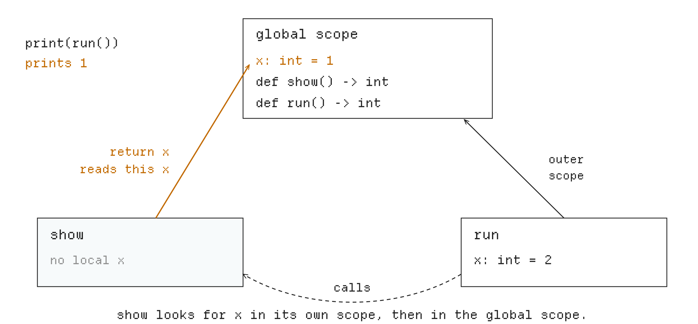

# PA3: Functions, Recursion and a Type Checker

*What does each name mean?*

**Due: Tuesday, November 10, 11:59 pm (Pacific).** Released Wednesday, October 21.

**What to do:** complete **Exercises 1 to 3** in `compiler/typecheck.py` and `compiler/codegen.py`, and write **three tests** of your own. Hand in your AI sessions, a design document in `docs/pa3-design.md`, or both. Section 7 says how to hand them in.

**Lectures:** Functions and the machine (10/26), Semantic analysis I (10/28).

In PA3 your compiler learns functions. Read this program before running it. There are two variables named `x`; which one does `show` read?

```python
x: int = 1

def show() -> int:
    return x

def run() -> int:
    x: int = 2
    return show()

print(run())
```

It prints `1`. `run` calls `show`, but `show` is written outside `run`, so its `x` is the one declared at the top. **A name means the declaration visible where the code is written, not where it is called from.**

You build two things. A **type checker**, which runs before your code generator, decides what every name means and checks that every value is used as its type allows: no adding a number to `True`, no calling a variable. It rejects a wrong program with one error, at the right line and column, before the program runs. Then your **code generator** learns functions, calls, `return` and global variables, recursion included.

## 1 Getting started

### 1.1 Setup

Use the two commands on PA3's OneWorld page to get the starter code. The second downloads it into a new folder and opens a shell there.

**Before editing PA3, bring over your PA2 work** with `tools/carry.py`. It copies your Python modules from `compiler/`, your tests from `test/mine/` and your design documents, while keeping the new course-provided files. Run these commands in order:

```sh
curl -fsSL https://downloads.oneworldai.com/oneworld-cli/install.sh | sh
oneworld assessment join <PA3 invite code>
python3 tools/carry.py ../PA2_FOLDER
python3 tools/doctor.py
```

Replace `<PA3 invite code>` with the code from staff and `../PA2_FOLDER` with the path to your PA2 folder; put paths containing spaces in quotes. If `carry.py` reports conflicting changes, it copies nothing. Compare the listed files before deciding which version to keep. **Do your PA3 work and submit from the new PA3 folder.**

**Check your carried work before starting PA3:** run `python3 tools/check.py pa1 pa2`. This runs your PA1 and PA2 tests, including your own. They should still pass if they passed in your PA2 folder. `make check-tests` also runs PA3, so it is not expected to pass yet.

PA3's starter adds:

| File | What it is |
|---|---|
| `compiler/typecheck.py` | your type checker (new) |
| `docs/pa3-design.md` | a short description of your design, if you hand one in |
| `test/mine/pa3/` | your own test programs |
| `tools/checktest.py` | a tester for where your checker reports errors (Section 2) |
| `test/pa3/` | 32 valid test programs, and 47 invalid ones in `test/pa3/bad/` |

**PA3 is graded with `--parser=python`:** Python's own parser reads the test programs instead of your PA2 parser, so a bug in your parser costs you no PA3 points. Use the option in every command, as this handout does:

```sh
python3 -m compiler check --parser=python prog.py             # run your checker only
python3 -m compiler run --parser=python prog.py               # compile and run
python3 -m compiler ll --parser=python prog.py                # show the IR
python3 -m compiler ast --parser=python --positions prog.py   # where each part starts
python3 tools/checktest.py --parser=python test/pa3           # where your checker finds errors
python3 tools/difftest.py --parser=python test/pa3            # what compiled programs print
make test-pa3                                                 # all PA3 tests, including yours
```

### 1.2 ChocoPy in PA3

PA3 programs are PA1 programs with functions:

- **A function** is declared at the top level: `def f(a: int, b: bool) -> int:`. Every parameter has a type, and `-> int` or `-> bool` is the type of the value it returns. **A function without `-> T` returns `None`**, usually used as a statement, such as `report(7)`. Section 5 describes other uses of its result. Write no return annotation for it; `-> None` is not a type annotation in ChocoPy.
- **A function body** starts with its declarations, local variables such as `total: int = 0` and `global` declarations such as `global count` (Section 4), then has at least one statement. `return e` returns the value of `e`; `return` alone leaves a function without `-> T`.
- **A program** starts with its global variables and functions, in any order, then its statements. A function may call any function, itself included (**recursion**).
- **Every variable declaration needs an initial literal**, such as `x: int = 0` or `flag: bool = False`. `x: int` alone, `x: int = f()` and `x: int = -5` are invalid. For a computed or negative value, declare with `0`, then assign in the statements. Parameters get their initial values from the caller.
- **Not in PA3:** functions inside functions and `nonlocal`, which the course's ChocoPy leaves out, and strings, lists, the literal `None`, `len`, `for` and `is`, which arrive in PA4. A call can still return `None` as described above. The compiler rejects unreleased features, for example with `strings arrive in PA4`.

The [course's ChocoPy page](https://github.com/fredfeng/CS160/blob/main/chocopy/SPEC.md) gives the grammar and the whole language.

### 1.3 Your code

**Your compiler now checks each program before compiling it.** `python3 -m compiler` reads the program, checks that it uses only the part of ChocoPy released so far, and calls your `check(tree)` in `compiler/typecheck.py`. **If `check` raises an error, the compiler prints it and stops; if `check` returns, it calls your code generator.** Until you write it, `check` accepts every program:

```python
def check(tree: ast.Module) -> None:
    """
    TODO(PA3): Add implementation

    @brief Check a whole program before it is compiled.
    ...
    Until you implement it, the checker accepts every program, so your PA1
    code generator keeps working.

    @param tree the program
    """
    # TODO(student): Suggested PA3 types: 'int', 'bool', and '<None>' for calls
    # without a return value. PA4 adds 'str', ('list', T), and '<Empty>' for [].
    return None
```

The rest of the file is yours. To reject a program, raise the error that the provided `error_at(node, message)` makes at a node (Section 3.3): `raise error_at(node, "unknown name secret")`. Use this `CompileError`, rather than Python's `TypeError`. You choose your symbol tables and type representation; `check` returns `None`, not the checked tree. You may attach types to nodes (for example `node.cp_type = "int"`) for your code generator to read, but the grader does not require that attribute name or representation.

In `compiler/codegen.py`, which you wrote in PA1, the original starter's `program` compiles the whole program into one function, `@main`, and hands a `def` to `statement` like any other statement. **This is a shortened view, not replacement code:** keep your PA1 implementation and extend it; the `...` marks omitted lines.

```python
class CodeGen:
    def __init__(self):
        self.module = Module()
        self.fn = Function("define i32 @main()")
        ...

    def program(self, tree: ast.Module) -> str:
        ...
        for node in tree.body:
            if isinstance(node, ast.AnnAssign):
                self.declaration(node)
            else:
                self.statement(node)
        self.module.add_function(self.fn.render("ret i32 0"))
        return self.module.render()
```

Change it so that top-level variables become globals and each `def` a function of its own (Section 6), with `self.fn` always the function being written. These helpers of `compiler/emit.py` handle several functions:

| Helper | What it does |
|---|---|
| `Function("define i32 @fn.f(i32 %n.arg)")` | starts a function with this first line; each function numbers its own names (`%t1`, ...) and labels |
| `self.fn.render("unreachable")` | returns the finished function, first ending its last block with this line if the block has no jump or `ret` |
| `self.module.add_function(text)` | adds a finished function to the program |
| `self.module.global_variable("@gv.x = global i32 5")` | adds a global variable |

Keep `generate(tree)` as the entry point of `compiler/codegen.py`. You may add helper modules directly in `compiler/`. The driver, emitter, runtime, tools and `compiler/config.py` are provided files; grading uses the staff copies. PA3's `config.py` must say `RELEASED = 3` without you editing it. If it does not, check that you joined PA3 and are in its working folder.

## 2 Testing your checker and compiler

**`python3 -m compiler check --parser=python prog.py`** runs Python's parser, the provided subset check and your type checker. It prints nothing (and exits with 0) when your checker accepts the program, and prints the error as `file:line:col: message` (and exits with 1) when it rejects it.

**`tools/checktest.py`** tests where your checker reports errors. **A program with a comment `# error: line:col`, as every program in a `bad/` folder has, must be rejected at exactly that line and column; every other program must be accepted.** With the starter's `check`:

```text
$ python3 tools/checktest.py --parser=python test/pa3/bad/wrong_arg_count.py
FAIL     test/pa3/bad/wrong_arg_count.py
         accepted, but expected an error at 6:7

0/1 tests passed
```

Each test ends with **`ok`**; **`FAIL`**, with the next line saying why; or **`BAD TEST`**, when the test's own `# error:` comment is malformed. The reasons for a `FAIL`:

- `accepted, but expected an error at 6:7`: no error found in a program that has one.
- `error at 4:16, expected 4:12 (cannot add int and bool)`: an error at the wrong place; your message is in parentheses.
- `rejected a valid program (unknown function second)`: an error in a program that has none.
- `crashed:` and a traceback: your checker raised something other than a `CompileError`.
- `your checker used more than 10 s of CPU time`: probably an endless loop.

**`tools/difftest.py`** runs the programs outside `bad/` folders as in PA1, under Python and compiled by your compiler, and compares what they print. Until your code generator handles `def`, a test such as `test/pa3/factorial.py` fails with `does not compile:` and the message `CodeGen.statement is not implemented for FunctionDef.`

**To test the checker before implementing function code generation, use `check` or `checktest.py` with `--parser=python`.** These commands do not call your code generator. Follow the checks after Exercises 1 and 2; failures in `difftest.py` caused by unfinished function code generation can wait until Exercise 3. `make test-pa3` runs both stages, so it is not expected to pass yet.

**To write a test,** put a valid program in `test/mine/pa3/`; Python's output is its answer key, and the special comments of PA1 still work. Put a program your checker must reject in `test/mine/pa3/bad/`, with a comment `# error: line:col` saying where: lines count from 1, the comment lines included, and so do columns. For example, `test/mine/pa3/bad/sum_in_product.py`:

```python
# error: 4:13
# only n + b is wrong: the product around it must not be reported too
def f(n: int, b: bool) -> int:
    return (n + b) * 2

print(f(1, True))
```

```text
$ python3 tools/checktest.py --parser=python test/mine/pa3/bad/sum_in_product.py
ok       test/mine/pa3/bad/sum_in_product.py

1/1 tests passed
```

`make test-pa3` runs both testers, with `--parser=python`, on `test/pa3` and on your tests in `test/mine/pa3`, and prints how many tests of each run passed and which failed.

**Rejection and run-time failure are different tests.** To reject a non-Boolean argument to `not`, put this file in `bad/` and use `checktest.py`:

```python
# error: 2:7
print(not 5)
```

`print(7 // 0)` is well typed but fails when run: keep it outside `bad/`, add `# expect-exit: 2`, and use `difftest.py`. That comment checks the compiled program's exit code, not an error message on standard output. Ordinary PA3 tests use Python as the answer key; they need neither `# cpython-differs` nor `# expect-stdout`. Write predicted output as an ordinary comment. Exact IR names and instruction numbering are not graded, and your tests should not require them.

**Reading a mismatch:** `expected` is Python's output and `got` is your compiled program's output; `output line 3` means the third printed line, not source line 3. Python's `-7 % 2` is `1`. Re-run the exact file with `python3 FILE` and `python3 -m compiler run --parser=python FILE` to compare them.

**For a failure in the tools, run `python3 tools/doctor.py` in your PA3 folder.** Rejoining an assignment does not install clang. If clang rejects `ptr` even in an unused runtime declaration such as `cp_print_str`, follow the doctor's setup advice; keep the provided declarations. A note that `ruff` is missing concerns formatting, not compiler execution.

For debugging, run one file directly: `python3 -m compiler check --parser=python FILE` for the checker, or `python3 -m compiler ll --parser=python FILE` for code generation. Put Python debug messages on standard error with `print(message, file=sys.stderr)` after `import sys`, so they do not mix with the IR. Running `checktest.py` directly shows these messages; `difftest.py` captures compiler output, so successful tests do not show them. `make test-pa3` shows only a summary; use the direct commands for debugging. A debug print appears only if execution reaches it: if parsing or the subset check fails, your checker does not run; if your checker rejects the program, code generation does not run. To check which file is loaded, use `python3 -c 'import compiler.typecheck as c; print(c.__file__)'` (or replace `typecheck` with `codegen`).

## 3 Background

### 3.1 Functions in the tree

`tree.body` holds the top-level declarations (`AnnAssign` and `FunctionDef`), then the statements; a function's `body` holds its declarations (`AnnAssign` and `Global`), then its statements. The new nodes:

| Node | Example | What it holds |
|---|---|---|
| `FunctionDef` | `def f(n: int) -> int:` | `name`, `args.args` (the parameters), `returns` (`None` without `-> T`), `body` |
| `arg` | the parameter `n: int` | `arg` (the name, `'n'`), `annotation` |
| `Global` | `global count` | `names[0]` |
| `Return` | `return n + 1` | `value` (`None` for `return` alone) |
| `Call` | `f(1, True)` | `func.id`, `args` |

A type such as `int` is a `Name` node: for `def f(n: int) -> int:`, `node.returns.id` is `'int'`.

For a variable declaration, `node.annotation.id` is its declared type and `node.target.id` its name. Read a constant from `node.value`, and a variable name from `node.id`; `str(node)` is only Python's description of an AST object. A binary operator is an instance: use `isinstance(node.op, ast.Add)`. **Check Boolean constants before integer constants:** Python considers `True` an instance of `int`, but ChocoPy's `bool` and `int` are separate types.

### 3.2 Where a node starts

Every statement and expression node records where its text starts: `lineno`, the line, counting from 1, and `col_offset`, the column, counting from 0. Error messages count columns from 1, as editors do; `error_at` adds the 1 for you. To see where each part of a program starts, ask the compiler:

```text
$ python3 -m compiler ast --parser=python --positions test/pa3/bad/paren_left_operand.py
FunctionDef 3:1
  Name 3:10
  Name 3:18
  Return 4:5
    BinOp 4:12
      BinOp 4:13
        Name 4:13
        Constant 4:17
      Name 4:22
  Name 3:27
Expr 6:1
  Call 6:1
    Name 6:1
    Call 6:7
      Name 6:7
      Constant 6:9
      Constant 6:12
```

Line 3 of that test is `def f(n: int, b: bool) -> int:`, and line 4 is `return (n + 1) * b`, indented by four spaces. **Parentheses belong to the expression around them:** the sum `n + 1` starts at `n`, in column 13, but the product starts at the `(`, in column 12. The `Name` nodes of line 3 are the types; parameters are not listed, and each starts where its name does. A call starts where its function's name does.

### 3.3 Reporting an error

**Your checker reports one error: the earliest in the file**, the one with the smallest line, and on that line the smallest column, whatever order it looks at the program in. This rule applies after parsing and the provided subset check succeed; either earlier stage can reject a program before your checker runs. **Only the checker's error position is graded;** word its messages as you like (this handout shows the reference checker's). The position is where this node starts:

| Error | Reported at |
|---|---|
| A name that is not declared, or a function used as a value | the name |
| A second declaration of a name in one scope | the second declaration: the variable, the parameter, the `def`, or the `global` statement |
| A variable, parameter or function named `int`, `bool`, `str` or `object` | the variable, the parameter, or the `def` |
| `global x` where `x` is not a global variable | the `global` statement |
| An assignment the code may not make, or of a value of the wrong type | the assignment's target |
| A starting value of the wrong type | the declared variable |
| An operation on values of the wrong types | the operation, where its text starts: its left side (or the `(` before it), or the `-` or `not` |
| A call of something that is not a function, or with the wrong number of arguments | the call |
| An argument of the wrong type | the argument |
| A condition that is not a `bool`, in `if`, `elif`, `while` or `a if c else b` | the condition |
| A conditional expression `a if c else b` whose `a` and `b` have different types | the conditional expression, which starts at `a` |
| A `return` of the wrong type | the `return` statement |
| A function declared `-> int` or `-> bool` that can end without returning a value | the `def` |

## 4 Names and scopes

A **declaration** gives a name its meaning: `x: int = 0` declares a variable, `def f(n: int) -> int:` declares the function `f` and, inside it, the parameter `n`, and `global x` in a function says that `x` there is the global variable. A **scope** is a part of the program with its own declarations: the **global scope** holds the top-level ones, which the whole program sees, and each function has a scope that only its body sees. Your checker keeps a **symbol table** for each scope: a dictionary from each name declared there to what it is, a variable and its type, or a function with the types of its parameters and result.



**Figure 1.** The scopes of the program at the start of this handout. `show` has no `x` of its own, so its `x` is the global one; the `x` of `run`, which calls it, is not in `show`'s scopes.

- **The global scope** holds `print` and `len` (`len` arrives in PA4, but its name is already taken), every global variable and every function. **All of them are known before any function body is checked,** so a function may call a function, or read a global variable, declared further down.
- **A function's scope** holds its parameters, its local variables, and the names it declares `global`. Top-level statements see only the global scope.
- **Reading a name** looks in the function's scope first, then in the global scope. A parameter or local with the name of a global variable or function **shadows** it, which is allowed: in that function, the name means the parameter or local. Finding nothing is an error, and so is finding a function (`print` and `len` included): a function is not a value.
- **Calling `f(...)`** looks up `f` the same way, and must find a function: finding nothing, or a variable, is an error. In `def run(total: int)`, the parameter `total` shadows a function `total`, so `total(3)` in `run` is an error.
- **Assigning `x = e`** needs permission. At the top level, `x` must be a global variable. In a function, `x` must be a parameter or local of that function, or be declared `global` in it. **A function may read a global variable freely, but must declare it `global` to assign to it.**
- **`global x`** must name a global variable: not a function, not `print` or `len`, not an undeclared name.
- **No name may be declared twice in one scope.** At the top level, `print` and `len` count as declared; in a function, parameters, locals and `global` names all count. The second declaration is reported and otherwise ignored: the first one stays.
- **`int`, `bool`, `str` and `object` are the names of types,** so no variable, parameter or function may have one of these names. Such a declaration is reported, but it still counts.

**Example 4.1.** Reading, assigning and shadowing a global variable:

```python
count: int = 0

def bump(n: int) -> int:
    global count
    count = count + n
    return count

def peek() -> int:
    count: int = 100
    return count

print(bump(5))
print(peek())
print(count)
```

It prints `5`, `100` and `5`. Its symbol tables:

```text
global scope   print   function
               len     function
               count   variable, int
               bump    function, (int) -> int
               peek    function, () -> int
bump           n       variable, int        declared global: count
peek           count   variable, int
```

In `bump`, `global count` permits the assignment, and both reads of `count` find nothing in `bump`'s table and go on to the global scope. In `peek`, the local `count` shadows the global one.

**Example 4.2.** Save the program of Example 4.1 as `count.py` and delete its line `global count`. The assignment in `bump`, now on line 4, becomes an error. Python fails only when `bump` runs; your checker rejects the program before it runs, at the target `count`:

```text
$ python3 count.py 2>&1 | tail -1
UnboundLocalError: cannot access local variable 'count' where it is not associated with a value
$ python3 -m compiler check --parser=python count.py
count.py:4:5: cannot assign to count: declare it global first
```

> **Exercise 1** (15 points). In `compiler/typecheck.py`, write `check` so that it builds the scopes of the program, finds the declaration each name means, and rejects each program that breaks a rule of this section, with its earliest error at the place Section 3.3 gives.
>
> **Check:** this command must end with `51/51 tests passed`, for the 32 valid programs and the 19 that break a rule of this section: `python3 tools/checktest.py --parser=python test/pa3/*.py test/pa3/bad/{assign_global,assign_to,call_variable,duplicate,function,global,local,redefine,type_name,unknown}*.py`. The other 28 programs in `test/pa3/bad/` need Exercise 2.

## 5 Types

A **type** tells what kind of value an expression has, and so what may be done with it. PA3 has `int` and `bool`, and a third type for calls: a call of a function without `-> T` has the type `<None>`, since it returns no value. **Your checker gives every expression a type, from the smallest parts up:** the type of `n + 1` comes from the types of `n` and `1`. **In PA3, two types match only when they are equal** (PA4 adds `None` and lists). Python is no judge here: it computes `1 + True` as `2`, but in ChocoPy, adding an `int` and a `bool` is an error. Python is the answer key for what valid programs print, not for which programs are valid.

| Expression | Its parts must be | Its type |
|---|---|---|
| `5`, `True` | | `int`, `bool` |
| `x` | a variable (Section 4) | its declared type |
| `-e`, `not e` | an `int`, a `bool` | `int`, `bool` |
| `a + b`, `a - b`, `a * b`, `a // b`, `a % b` | two `int`s | `int` |
| `a < b`, `a <= b`, `a > b`, `a >= b` | two `int`s | `bool` |
| `a == b`, `a != b` | two `int`s, or two `bool`s | `bool` |
| `a and b`, `a or b` | `bool`s | `bool` |
| `a if c else b` | `c` a `bool`; `a` and `b` of the same type | that type |
| `f(e1, ..., en)` | as many arguments as `f` has parameters, each of its parameter's type | the type after `f`'s `->`, or `<None>` |
| `print(e)` | exactly one argument, an `int` or a `bool` | `<None>` |

Statements have rules too:

- **A declaration `x: T = v`:** `v` must have type `T`. **An assignment `x = e`:** `e` must have the declared type of `x`.
- **A condition** of `if`, `elif` or `while` must be a `bool`; ChocoPy does not treat `0` as false.
- **`return e`:** `e` must have the function's return type. `return` alone has the type `<None>`, so **in a function declared `-> int` or `-> bool` it is an error. In a function without `-> T`, use `return` or return any expression of type `<None>`:** for example `return g()`, `return print(7)`, or `return g() if flag else h()` when both functions have no return annotation and `flag` is a `bool`.
- **An expression statement,** such as `bump(5)`, may have any type; its value is dropped.
- **A function declared `-> int` or `-> bool` must return a value on every path.** A list of statements returns on every path if one of its statements is a `return`, or an `if` whose body and `else` part both return on every path. An `elif` is an `if` inside the `else` part, so a chain counts only if it ends with `else`. **A `while` loop never counts,** not even `while True`: the rule looks at the statements, not at the values.

**Check both branches of a conditional expression**, even when the condition is `True` or `False`. They must have the same type: `1 if True else False` is invalid. At run time only the selected branch runs, as in PA1. The full ChocoPy language can give mixed branches the type `object`; our subset has no `object`. Signed 32-bit overflow is outside the assignment's tests; your tests must avoid it, and keep recursion below Python's recursion limit.

**Avoid errors caused only by an unknown type.** Give an unknown name, a function used as a value, or an invalid expression a special type such as `'<error>'`. Unary, arithmetic, comparison and Boolean expressions propagate it from their parts without another error. A conditional expression propagates it from either result branch, or gets it when those branches have incompatible types. Thus in the test of Section 2 only `n + b` is reported, not the surrounding product. Check all children, even after finding a mistake.

**A type that is still known can reveal another error.** A call of a user-defined function keeps its declared return type even if its arguments are wrong; check argument types when the argument count is correct. A conditional expression with compatible result branches keeps their type even if its condition is wrong. For example, with `x` a `bool`, `x = 1 if 2 else 3` has both a bad condition and a wrong assignment type: report the target `x`, which comes first. An unknown or non-function call has the error type, as does an invalid built-in call to `print`; a valid `print` has type `<None>`.

**How the rules are written.** The ChocoPy manual writes each type rule as a fraction: above the line, what must hold for the parts; below it, the type of the whole. `O |- e : T` reads "in `O`, the expression `e` has type `T`"; `O`, the **environment**, gives the type of every name visible there, as your symbol tables do (the manual's has more parts, left out here). Two of the rules:

```text
O |- e1 : int     O |- e2 : int     op is +, -, *, // or %
----------------------------------------------------------  [arith]
                   O |- e1 op e2 : int

O(f) = (T1, ..., Tn) -> T0     O |- e1 : T1   ...   O |- en : Tn
----------------------------------------------------------------  [invoke]
                    O |- f(e1, ..., en) : T0
```

A **derivation** proves the type of an expression by applying a rule to each of its parts. For `not n > 0`, with `n` an `int` parameter:

```text
  O(n) = int
-------------- [var-read]    -------------- [int]
 O |- n : int                 O |- 0 : int
--------------------------------------------- [int-compare]
              O |- n > 0 : bool
           ----------------------- [not]
           O |- not n > 0 : bool
```

Your checker does the same work without drawing the tree: checking `not n > 0` checks `n > 0`, which checks `n` and `0`, and each check returns the type below its rule's line.

**Example 5.1.** This program has two errors, `count + flag` on line 2 and the starting value of `limit` on line 5:

```python
def total(count: int) -> int:
    return count + flag

flag: bool = True
limit: int = False
print(total(1))
```

```text
$ python3 -m compiler check --parser=python two_errors.py
two_errors.py:2:12: cannot add int and bool
```

A checker that fills in the global scope before it looks at function bodies finds line 5 first, but line 2 comes first in the file. Keep the errors you find, and at the end report the earliest.

**Example 5.2.** `test/pa3/bad/missing_return_while.py`:

```python
# error: 3:1
# a while loop does not count as returning on every path, even while True
def first_square_above(limit: int) -> int:
    i: int = 0
    while True:
        if i * i > limit:
            return i
        i = i + 1

print(first_square_above(10))
```

```text
$ python3 test/pa3/bad/missing_return_while.py
4
$ python3 -m compiler check --parser=python test/pa3/bad/missing_return_while.py
test/pa3/bad/missing_return_while.py:3:1: first_square_above must return a value on every path
```

Python never reaches the end of the function, but its body is a declaration and a loop, and a loop never counts. A `return -1` after the loop makes the program valid.

> **Exercise 2** (25 points). In `check`, give every expression its type and apply the rules of this section to every expression and statement, reporting each mistake once and only the earliest error of a program.
>
> **Check:** `python3 tools/checktest.py --parser=python test/pa3` must end with `79/79 tests passed`. Every PA1 program is valid, and your checker now runs on them too, so `python3 tools/checktest.py --parser=python test/pa1` must pass all 35 tests.

## 6 Functions in LLVM

**Python builds the instructions; LLVM executes them later.** Your expression routine returns text naming a value, such as `"%t3"`, together with its type. It cannot read the run-time value of `%t3` in Python. Emit instructions that use that name, including a `call` for a ChocoPy function; do not execute the ChocoPy function in your compiler's Python process.

Choose how to print from that returned type: test `t == "bool"`, not `isinstance(value, bool)` on an IR string. As in PA1, extend a Boolean result from `i1` to `i32` with `zext` before calling `cp_print_bool`. Start a fresh local-variable table for each function and for `@main`; keep the global-variable table separately.

**From PA3 on, top-level variables are LLVM globals.** In PA1, `x: int = 5` reserved memory inside `@main` with `alloca`. That memory belongs to one call of one function: no other function can name it, and it is freed when the call returns. Functions must read and write top-level variables, so each becomes a **global**: memory that exists for the whole run, under the same name in every function. `@gv.x = global i32 5` defines it with its starting value; `load` and `store` use it like memory from `alloca`.

**Example 6.1.** This program prints `6`:

```python
x: int = 5
x = x + 1
print(x)
```

A PA1 compiler starts `@main` with `%x.addr = alloca i32` and `store i32 5, ptr %x.addr`, and uses `%x.addr` where this IR uses `@gv.x`:

```llvm
@gv.x = global i32 5

define i32 @main() {
entry:
  %t1 = load i32, ptr @gv.x
  %t2 = add i32 %t1, 1
  store i32 %t2, ptr @gv.x
  %t3 = load i32, ptr @gv.x
  call void @cp_print_int(i32 %t3)
  ret i32 0
}
```

The rules:

- **Types:** `int` is `i32`, `bool` is `i1`, and a function without `-> T` returns `void`, no value. A global `b: bool = True` is `@gv.b = global i1 true`.
- **A function** `def f(a: int, b: bool) -> int:` is `define i32 @fn.f(i32 %a.arg, i1 %b.arg)`; `%a.arg` is the value the caller passed. A function may assign to its parameters, so **each parameter gets memory, `%a.addr` from `self.fn.slot`, that starts out holding `%a.arg`**. Each local variable gets memory holding its starting value.
- **Every call has its own parameters and locals:** `alloca` reserves memory for the current call only, so while `fact(3)` waits for `fact(2)`, each has its own `n`. The memory of one call is its **stack frame**, freed when the call returns.
- **A name** is the current function's parameter or local if it has one, and otherwise the global `@gv.name`. **In `@main`, every variable is a global.**
- **A call** computes its arguments **from left to right**, then calls: `%t4 = call i32 @fn.f(i32 %t2, i1 %t3)`. The call of a function without `-> T` gets no name: `call void @fn.g(i32 %t1)`.
- **An expression of type `<None>`** still performs its calls, but has no LLVM result to name. For `g() if flag else h()`, branch first and call only the selected function; no result slot is needed. If your expression interface requires a value, use `null` with LLVM type `ptr` after emitting the call. Never emit `%t1 = call void ...`, `alloca void` or `store void`.
- **`return e`** is `ret i32` or `ret i1` with the value of `e`. Without `-> T`, `return` is `ret void`, and `return g()` calls `g`, then does `ret void`.
- **The end of a function:** a last block without a jump or `ret` ends with `ret void` in a function without `-> T`, and with `unreachable` in one that returns a value: Exercise 2 made sure that no run gets there. Statements after a `return` never run, but the checker still checks their types. If you emit them, `self.fn.emit` starts a fresh `dead.N` block when the next instruction follows a `ret`; it drops a second immediate jump or `ret`.
- **`@main`** holds the top-level statements, then `ret i32 0`, as in PA1. The functions may come in any order: a call may name a function that comes later.
- **Prefix the names** `@fn.f` and `@gv.x`, because a program may define its own `main`, or `puts`, which the runtime calls to print `True`; and use `%a.arg`, because a parameter may be named `t1` or `entry`. No ChocoPy name contains a dot, so these never clash.

**Example 6.2.** Recursion. This program prints `120`:

```python
def fact(n: int) -> int:
    if n <= 1:
        return 1
    return n * fact(n - 1)

print(fact(5))
```

```llvm
define i32 @fn.fact(i32 %n.arg) {
entry:
  %n.addr = alloca i32
  store i32 %n.arg, ptr %n.addr
  %t1 = load i32, ptr %n.addr
  %t2 = icmp sle i32 %t1, 1
  br i1 %t2, label %if.then.1, label %if.end.1
if.then.1:
  ret i32 1
if.end.1:
  %t3 = load i32, ptr %n.addr
  %t4 = load i32, ptr %n.addr
  %t5 = sub i32 %t4, 1
  %t6 = call i32 @fn.fact(i32 %t5)
  %t7 = mul i32 %t3, %t6
  ret i32 %t7
}

define i32 @main() {
entry:
  %t1 = call i32 @fn.fact(i32 5)
  call void @cp_print_int(i32 %t1)
  ret i32 0
}
```

Block `if.then.1` ends with `ret`, so the `if` adds no jump from it to `if.end.1`, where `n * fact(n - 1)` is computed from left to right: `%t3` is `n`, and `%t6` the result of the recursive call. `@main` numbers its names from `%t1` again.

`self.fn.labels("if.then", "if.end")` returns two **strings**: store them in Python variables such as `then, end`, use `self.fn.label(then)` to start the block, and `f"br label %{end}"` to jump. A label does not include `%` or `:`. `label` adds a fall-through jump if the previous block is still open. A call of `cp_error_div()` does not end a block by itself: emit `unreachable` immediately after it, as in PA1.

**Example 6.3.** A function without `-> T` that assigns a global variable:

```python
count: int = 0

def bump(n: int):
    global count
    count = count + n

bump(5)
bump(2)
print(count)
```

It prints `7`:

```llvm
@gv.count = global i32 0

define void @fn.bump(i32 %n.arg) {
entry:
  %n.addr = alloca i32
  store i32 %n.arg, ptr %n.addr
  %t1 = load i32, ptr @gv.count
  %t2 = load i32, ptr %n.addr
  %t3 = add i32 %t1, %t2
  store i32 %t3, ptr @gv.count
  ret void
}

define i32 @main() {
entry:
  call void @fn.bump(i32 5)
  call void @fn.bump(i32 2)
  %t1 = load i32, ptr @gv.count
  call void @cp_print_int(i32 %t1)
  ret i32 0
}
```

The `load` in `@main` reads what the `store` in `@fn.bump` wrote, because both name `@gv.count`. `bump` ends with `ret void`, and its calls get no name.

**Example 6.4.** Both branches return:

```python
def sign(n: int) -> int:
    if n < 0:
        return -1
    else:
        return 1

print(sign(-5))
```

It prints `-1`. The IR of `sign`:

```llvm
define i32 @fn.sign(i32 %n.arg) {
entry:
  %n.addr = alloca i32
  store i32 %n.arg, ptr %n.addr
  %t1 = load i32, ptr %n.addr
  %t2 = icmp slt i32 %t1, 0
  br i1 %t2, label %if.then.1, label %if.else.1
if.then.1:
  %t3 = sub i32 0, 1
  ret i32 %t3
if.else.1:
  ret i32 1
if.end.1:
  unreachable
}
```

Nothing jumps to `if.end.1`, but the `if` still starts that block, and every block must end with a jump, a `ret` or `unreachable`. `unreachable` also tells LLVM that no run gets there.

> **Exercise 3** (20 points). In `compiler/codegen.py`, compile top-level variables to globals, each `def` to an LLVM function, and calls and `return` statements, following the rules of this section.
>
> **Check:** `python3 tools/difftest.py --parser=python test/pa3` must pass all 32 tests, and `python3 tools/difftest.py --parser=python test/pa1` must still pass. Also run `python3 tools/difftest.py --parser=python --verify test/pa3` to check your IR's blocks and uses of names. Then `make test-pa3` must pass: every test in `test/pa3`, and your three tests.

## 7 Submitting your work

Hand in these three things:

- **Your code**, with Exercises 1 to 3 done.
- **Three tests of your own** in `test/mine/pa3/`: a program that would print something different if names were looked up where a function is called instead of where it is written; a program your checker must reject, in `test/mine/pa3/bad/` with its `# error:` line; and a call whose result changes if arguments are passed in the wrong positions, such as a recursive `sub(a, b)`. Evaluating arguments left to right is also required; calls that change a global can test that separately. Say in a comment what each test prints, or where it must be rejected, and which mistake it catches. To check that it catches that mistake, make the mistake in a copy of your compiler and see the test fail. Staff also run your tests on their own compiler: a test it fails is wrong. **Your tests may cover the same behavior as public tests; they do not need to discover a new bug.** Write your own programs, rather than copying this handout or `test/`.
- **Your sessions, your design document, or both.** Sessions count if they are Claude Code or Codex sessions started in your PA3 folder. The design document is `docs/pa3-design.md`: about one page, under the headings in the file (your scopes, your type rules, functions in LLVM, your tests), written by you; one written with AI earns no points.

**Hand them in with OneWorld,** as in PA1: in your PA3 folder, run `oneworld assessment submit`, step 3 of the PA3 page. It sends your changes from the starter, including committed and uncommitted files that Git does not ignore and the code of your earlier assignments. If handing in sessions, select all relevant PA3 sessions at the session prompt. With a design document alone, no AI session is needed. No video or ZIP is required.

```sh
oneworld assessment status   # shows what submit would send
oneworld assessment submit   # hand it in
```

Check that the status names **PA3** before submitting, then keep the submission receipt. A receipt confirms upload; it does not mean the tests passed or that grading is complete. `make test-pa3` checks correctness locally and may still report that you have no tests of your own; passing public tests alone does not satisfy the three-test requirement.

**Your tests (20 points)** are graded for catching the stated mistakes (8), correct expected results and explanations (6), and reproducible checks and interpretation of the results (6). This is separate from the 20 points for sessions or a design document.

**Grading.** PA3 is worth 5% of your course grade. It is out of 100 points: **60** for your compiler (**15** for Exercise 1, **25** for Exercise 2 and **20** for Exercise 3, checked with `--parser=python` on programs you have not seen), **20** for your three tests, and **20** for your sessions or your design document. Staff grade each one you hand in on its own and keep the higher grade: **Excellent** (20), **Good** (15), **Fair** (10) or **Poor** (5), and 0 if you hand in neither. Sessions are graded mainly on whether your prompts work out the design details, such as which declaration each name refers to, which type rule applies where, and how a call passes its arguments; a design document, on how well it explains your design decisions and how you checked them. Short sessions are fine: a few prompts that think through the design are enough.
