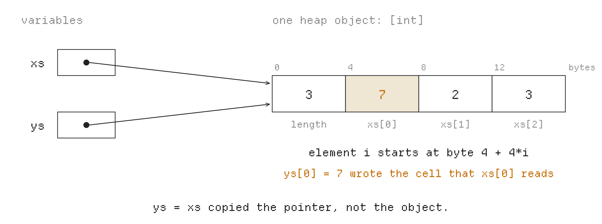

# PA4: Lists and Strings on the Heap

*Where does a value live?*

**Due: Monday, November 16, 11:59 pm (Pacific).** Released Monday, November 2.

**What to do:** complete **Exercises 1 to 3** in `compiler/typecheck.py` and `compiler/codegen.py`, and write **three tests** of your own. Hand in your AI sessions, a design document in `docs/pa4-design.md`, or both. Section 7 says how to hand them in.

**Lectures:** Semantic analysis II (11/2), Runtime organization (11/4). The section in the week of November 9 is a PA4 lab.

PA3 gave your compiler functions and a type checker. Its variables held numbers or Booleans; a function without a return annotation could also produce `None`. PA4 adds strings, lists and the literal `None`. Take this program:

```python
xs: [int] = None
ys: [int] = None
xs = [1, 2, 3]
ys = xs
ys[0] = 7
print(xs[0])
```

It prints `7`. **`ys = xs` copies the list's address: afterwards both variables refer to the same list,** so a change made through `ys` is seen through `xs`. A list's length can depend on a computation, and a list may outlive the function that made it. The course stores lists in the **heap**, memory the program asks for while it runs, and a variable holds only an address.

**Your job is to extend your type checker and your code generator to strings, lists and `None`:** give them types, build them in the heap, and check at run time every access that could go wrong, such as an index past the end of a list, so that the program stops with the right error.

## 1 Getting started

### 1.1 Setup

Use the two commands on PA4's OneWorld page to get the starter code. The second downloads it into a new folder and opens a shell there. Its driver accepts strings, lists and `None`.

**Before editing PA4, bring over your PA3 work** with `tools/carry.py`. It copies your Python modules from `compiler/`, your tests from `test/mine/` and your design documents, while keeping the new course-provided files. Run these commands in order:

```sh
curl -fsSL https://downloads.oneworldai.com/oneworld-cli/install.sh | sh
oneworld assessment join <PA4 invite code>
python3 tools/carry.py ../PA3_FOLDER
python3 tools/doctor.py
```

Replace `<PA4 invite code>` with the code from staff and `../PA3_FOLDER` with the path to your PA3 folder; put paths containing spaces in quotes. If `carry.py` reports conflicting changes, it copies nothing. Compare the listed files before deciding which version to keep. **Do your PA4 work and submit from the new PA4 folder.**

**Check your carried work before starting PA4:** run `python3 tools/check.py pa1 pa2 pa3`. The public tests and your tests of earlier features should still pass. If an own test only expected a feature newly supported in PA4 to be rejected, move it out of `bad/` and remove its obsolete `# error` comment once that feature works. `make check-tests` also runs PA4, so it is not expected to pass yet. After carrying, PA4 programs may still be rejected by your PA3 checker, and the new operations still need code generation.

| File | What it is |
|---|---|
| `compiler/typecheck.py` | your type checker from PA3; Exercise 1 extends it |
| `compiler/codegen.py` | your code generator from PA1 and PA3; Exercises 2 and 3 extend it |
| `test/mine/pa4/` | your own test programs |
| `docs/pa4-design.md` | a short description of your design, if you hand one in |
| `test/pa4/` | 36 test programs, and 21 more in `test/pa4/bad/` that must be rejected |
| `runtime/runtime.c` | the C functions your IR calls |

**PA4 is graded with `--parser=python`, as PA3 was.** Python's parser reads the test programs, so a PA2 parser bug costs no PA4 points. Use that option while developing PA4:

```sh
python3 -m compiler check --parser=python prog.py            # run your checker only
python3 -m compiler run --parser=python prog.py              # compile and run
python3 -m compiler ll --parser=python prog.py               # show the IR
python3 -m compiler ast --parser=python --positions prog.py  # show source positions
python3 tools/checktest.py --parser=python test/pa4          # check error positions
python3 tools/difftest.py --parser=python test/pa4           # compare output
make test-pa4                                               # public and own tests
```

### 1.2 ChocoPy in PA4

- **Types:** `str`, and list types `[T]`: `[int]`, `[bool]`, `[str]`, `[[int]]` (a list of lists of numbers), and so on.
- **A starting value is still a literal,** so a list variable starts as `None` and gets a list later: `xs: [int] = None`, then `xs = [1, 2, 3]`. **A string is never `None`:** `s: str = "cs"`.
- **String literals** are in double quotes and hold ASCII characters; the only escapes are `\"`, `\n`, `\t` and `\\`.
- **New expressions:** `None`; list displays, lists written out such as `[1, 2, 3]` and `[]`; `len(e)`; `e[i]`, element `i` of a list or string; `a + b` on two strings or two lists; `==` and `!=` on strings; and `a is b`.
- **New statements:** `xs[i] = e`; `for x in e:`, with `x` declared earlier; and `print` of a string.
- **An index counts from 0 and must be less than the length.** Python counts a negative index from the end, but **ChocoPy does not:** `xs[-1]` stops the program with an error.
- **PA3's function rules continue:** a function without `-> T` returns `None`. A function returning `int`, `bool` or `str` must return a value on every path. A function returning a list may fall through or use a bare `return`, producing `None`.

The tree nodes are the ones your PA2 parser builds: `List` (also for a type such as `[int]`), `Subscript` for `e[i]`, `For`, and `Constant` holding a string or `None`.

### 1.3 Your code

**No new stub arrives: you extend the code you wrote in PA1 to PA3.** In `compiler/codegen.py`, `declaration` now also gets `s: str = "cs"` and `xs: [int] = None`, `statement` gets `xs[i] = e` and `for`, and `expr` gets the new expressions. The PA3 stub of `check`, in `compiler/typecheck.py`, already suggested how to write the new types:

```python
def check(tree: ast.Module) -> None:
    """
    ...
    Record each expression's type on its node, for example
    `node.cp_type = "int"`, if your code generator wants to read it.
    ...
    """
    # TODO(student): Suggested PA3 types: 'int', 'bool', and '<None>' for calls
    # without a return value. PA4 adds 'str', ('list', T), and '<Empty>' for [].
    return None
```

**The driver type-checks every program before compiling it,** so `python3 -m compiler run --parser=python` reaches your code generator only with a program your checker accepts; that is why the type rules come first, in Exercise 1. Use `check` and `checktest.py` to finish that exercise before the new code generation works. To compile `a + b` or `print(e)`, your generator must know whether the values are numbers, strings or lists. You may attach types to nodes or share that information another way; the grader does not require a particular representation or attribute name.

The starter also gives you `self.module.string(value)`, in `compiler/emit.py`, which adds the constant object of a string literal to your program's IR and returns its name, such as `@str.1` (the same literal always gets the same name). The `declare` lines the starter puts in every program's IR already cover the runtime functions of Sections 3, 5 and 6, and `llvm.memcpy`.

### 1.4 From the lectures to the assignment

Lecture 9 checks types without running a program. Lecture 10 follows values and changes to memory in the order the program runs. Lecture 11 turns a list's layout and the conditions for an access into LLVM instructions. PA4 connects those steps: **the checker decides what a value can be; the generator preserves what the program does; the runtime reports failures that types alone cannot exclude.** A well-typed program may still stop at a defined run-time error, such as an index out of bounds.

The lecture compiler is a small teaching example. **Use this handout and the course specification for the assignment's full rules and interfaces:**

- Declare a list variable with `None`, then assign its display in a separate statement. A display such as `[]` or `[10, 20, 30]` cannot initialize a declaration in the course grammar.
- Keep PA3's functions without return annotations. Section 4 gives the full rules for `None` and `[]`, including uses outside an assignment such as `len([])` and `xs is None`.
- Use the provided `cp_alloc(i64)` and `cp_error_*` functions, with the exit codes in Section 6. The lecture's `chocopy_alloc` and `chocopy_error` names are not starter interfaces.
- For `xs[i] = e`, evaluate **`e`, then `xs`, then `i`, then check and store**. Follow Section 6 even when adapting a lecture fragment that computes the target first.

## 2 Testing your compiler

PA4 uses both testers you know. **`tools/checktest.py`**, from PA3, runs your type checker only: **each program in a `bad/` directory must be rejected at the line and column its `# error: line:col` comment gives, and every other program must be accepted.** Only the position counts, not the message; a program that should have been rejected gets, for example, `accepted, but expected an error at 4:6`. **`tools/difftest.py`**, from PA1, runs each program with Python and with your compiler, and compares what they print and whether they stop with an error.

**The PA4 tests read programs with Python's parser,** so a mistake in your PA2 parser costs no points here. `make test-pa4` passes `--parser=python` to both testers, and grading uses Python's parser too; checktest uses it by default, but difftest only when you pass `--parser=python`. On a Mac, also pass `--verify`, as in PA1: clang there accepts some broken IR that the grading machine, which runs Linux, may reject. In this run, the compiler calls the wrong error function for `len` of `None`:

```text
$ python3 tools/difftest.py --parser=python test/pa4/err_len_none.py test/pa4/for_list.py
FAIL     test/pa4/err_len_none.py
         exit code 4, expected 1
ok       test/pa4/for_list.py

1/2 tests passed
```

**Python stops with exit code 1 after an uncaught exception, but ChocoPy has one code for each kind of error** (Section 6), so a test that must stop with an error gives its code in an `# expect-exit` comment; `exit code 4, expected 1` means that your program stopped with the wrong one. Another kind of `FAIL` is new in PA4: `your program crashed after printing 3 line(s): SIGSEGV: a bad memory access, such as a missing check or a wrong address`. The operating system stopped your program because it read or wrote memory that is not its own, usually through a `None` that was not checked, or at a wrong address. Run with `python3 -m compiler run --parser=python`, such a program ends with `the program crashed with SIGSEGV` and exit code 139.

**To write a test,** put a ChocoPy program in `test/mine/pa4/`, or in `test/mine/pa4/bad/` if it must be rejected. These comments say what Python cannot check:

| Comment | Meaning |
|---|---|
| `# error: 4:6` | the checker must reject the program at line 4, column 6 (only in a `bad/` directory) |
| `# expect-exit: 3` | the program must stop with exit code 3 (and Python must stop with an error too) |
| `# cpython-differs` | do not run Python; the `# expect-stdout` comments give the output |
| `# expect-stdout: 3` | the program must print the line `3` (one comment per line; only with `# cpython-differs`) |

**A test that must stop with an error should print something first,** so that it also checks when the error happens. Python accepts a negative index, so a test of one needs `# cpython-differs`:

```python
# cpython-differs
# expect-exit: 3
# expect-stdout: 3
# Python prints 30 for xs[-1]; ChocoPy stops with "Index out of bounds".
xs: [int] = None
xs = [10, 20, 30]
print(len(xs))
print(xs[-1])
```

Without its first line, difftest reports `BAD TEST`, since Python's output would then be the answer. `make test-pa4` runs both testers on `test/pa4` and on your tests in `test/mine/pa4`, and lists the tests that fail.

## 3 Background

### 3.1 Objects on the heap

Memory is a long row of bytes, numbered from 0; a byte's number is its **address**, and a **pointer** is a value that holds one (in LLVM, of type `ptr`, 8 bytes). The memory `alloca` reserves disappears when its function returns. The **heap** is memory the program asks for while it runs, and keeps until it ends; asking for it is called **allocation**. `cp_alloc(n)` returns the address of `n` new bytes, all 0, or stops the program with `Out of memory` (exit code 5) if there are none left.

**Each string and each list is an object, a block of memory, and every object has the same layout, or order of parts: its length, an `i32`, followed by its elements.** Lists, and strings made while the program runs, are allocated in the heap; a string literal is a constant (Section 3.2). A variable of type `str` or `[T]` holds only the object's address. **`None` is the address 0, written `null` in LLVM,** which no object has. Assigning a list copies its address, never the object, so two variables can reach one object, as in Figure 1.



**Figure 1.** The program at the start of this handout, after `ys[0] = 7`: `xs` and `ys` hold the address of one object. Its length comes first, and element `i` of an `[int]` starts at byte `4 + 4 * i`.

Where an element starts depends on the size of the elements, and on a rule called **alignment**: a value of 8 bytes, such as a pointer, starts at an address divisible by 8. So in a list of strings or of lists, whose elements are pointers, 4 unused bytes follow the length:

| ChocoPy type | Each element | The object in LLVM | Element `i` starts at byte | Bytes for `n` elements |
|---|---|---|---|---|
| `str` | a character, `i8` | `{ i32, [0 x i8] }` | `4 + i` | `4 + n` |
| `[bool]` | `i1`, one byte in memory | `{ i32, [0 x i1] }` | `4 + i` | `4 + n` |
| `[int]` | `i32` | `{ i32, [0 x i32] }` | `4 + 4 * i` | `4 + 4 * n` |
| `[str]`, `[[int]]`, ... | `ptr` | `{ i32, [0 x ptr] }` | `8 + 8 * i` | `8 + 8 * n` |

`{ A, B }` is an LLVM structure, an `A` followed by a `B`, with padding when alignment needs it. `[0 x i32]` is a zero-length array in the layout type. The allocation reserves room for the actual elements after the header, and the header records their count. For `[bool]`, `i1` uses one byte per stored element; do not pack eight elements into a byte.

### 3.2 Addresses with `getelementptr`

**`getelementptr` computes the address of an element. It neither reads memory nor checks that the element exists.** These two lines load element 3 of the list whose address is in `%t38`:

```llvm
  %t42 = getelementptr { i32, [0 x i32] }, ptr %t38, i32 0, i32 1, i32 3
  %t43 = load i32, ptr %t42
```

After the address, `i32 0` means the object at `%t38` itself, `i32 1` its field 1, the elements (field 0 is the length), and `i32 3` element 3 of those. **The same instruction gives the size of a new object:** where element `n` would start, in an object at address 0, is the size of an object with `n` elements, and `ptrtoint` turns that address into a number. These lines, from the program at the start, allocate a list of three numbers, 16 bytes, and store its length at byte 0:

```llvm
  %t1 = getelementptr { i32, [0 x i32] }, ptr null, i32 0, i32 1, i32 3
  %t2 = ptrtoint ptr %t1 to i64
  %t3 = call ptr @cp_alloc(i64 %t2)
  store i32 3, ptr %t3
```

**Let `getelementptr` compute where each element starts, with the object type from the table;** then one piece of code works for every element type, alignment included.

Use plain `getelementptr` here. Adding `inbounds` is a promise to LLVM about valid address arithmetic, not a bounds check; in particular, the sizing calculation starts from `null` and must not make that promise.

A string literal is a constant object with the layout of `{ i32, [0 x i8] }`. `self.module.string("cs")` adds this line to your program's IR and returns its name, here `@str.1`, which is the constant's address:

```llvm
@str.1 = private unnamed_addr constant { i32, [2 x i8] } { i32 2, [2 x i8] c"cs" }
```

## 4 Types of strings, lists and `None`

**PA4 adds `str`, list types `[T]` and the helper type `<Empty>` for `[]`. It also uses PA3's `<None>` for the literal `None` as well as for calls without a return value.** These helper types are internal to your checker; programmers cannot use them as annotations. The rules, from the [course's ChocoPy page](https://github.com/fredfeng/CS160/blob/main/chocopy/SPEC.md):

- **Assignment compatibility says whether a value of type S fits an expected type T**, in a declaration, assignment, argument or `return`. It holds when S is T; when S is `<None>` and T is `<Empty>` or any list type; when S is `<Empty>` and T is any list type; or when S is `[<None>]` and T is `[U]`, provided `<None>` is compatible with U. These are all the cases; the helper-type cases also matter when computing joins. Thus `[None]` fits `[[int]]`, but `None` does not fit `int`, `bool` or `str`; `[bool]` does not fit `[int]`; and `[[]]`, of type `[<Empty>]`, does not fit `[[int]]`.
- **The join of two types** is whichever of the two the other one fits: the join of `<None>` and `[int]` is `[int]`. For the checker's helper types, `<None>` also fits `<Empty>`, so their join is `<Empty>`. **A display** `[e1, ..., en]` has type `[J]`, where `J` joins the types of the elements from left to right. Thus `[None, [1]]` has type `[[int]]`, while `[None, []]` has type `[<Empty>]`: it is a valid display, but does not fit a variable of type `[[int]]`. **If two types have no join, the display is an error,** as `[1, True]` is. PA3's `a if c else b` joins its branches the same way.
- **`<Empty>` is not a list type `[T]`,** which `+`, `for` and indexing need: `[] + xs`, `for x in []` and `[][0]` are errors, while `xs = []` and `len([])` are fine.
- **`e[i]`** needs an `int` index. Its type is `T` on a list `[T]`, and `str` on a `str`. **Only an element of a list can be assigned,** never a character of a string.
- **`a + b`** takes two `int`s, two `str`s, or two lists whose element types have a join `J`; the result is then a `[J]`.
- **`==` and `!=`** take two `int`s, two `bool`s or two `str`s. **`is`** takes lists, `None` or `[]`, never an `int`, `bool` or `str`.
- **`for x in e`:** `e` is a `str`, whose elements are `str`s, or a list `[T]`, whose elements are `T`s. `x` must be a variable that could be assigned there (in a function, a global variable needs `global`), and each element must fit its type.
- **`len(e)`** needs a `str`, a list or `[]`; **`print(e)`** needs an `int`, `bool` or `str`.

Report errors as in PA3: the earliest in the file, an operation on the wrong types (`+` and `is` included) where the operation starts, a value that does not fit at the declared name or the assignment's target, and so on. The new kinds of errors are reported here:

| Error | Reported at |
|---|---|
| index that is not an `int` | the index |
| indexing a value that is neither a list nor a `str` | the indexing expression, where it starts |
| assignment to an element of a `str` | the assignment's target |
| display whose elements have no join | its `[` |
| `for` over a value that is neither a list nor a `str` | the value after `in` |
| loop variable that cannot hold the elements | the loop variable |
| `len` or `print` of a value of the wrong type | the argument |

**Example 4.1.** A display without a join. Python runs this program without complaint, which is why type errors are tested with checktest, not difftest:

```text
$ cat mixed.py
xs: [int] = None
xs = [1, True]
$ python3 -m compiler check --parser=python mixed.py
mixed.py:2:6: list elements have incompatible types
```

**Example 4.2.** Joins with `None` and `[]`. This program is accepted, and prints `2` and `0`: `<None>` fits `[int]`, so the display is an `[[int]]`.

```python
xss: [[int]] = None
xss = [None, [1]]
print(len(xss))
xss = []
print(len([]))
```

With `xss = [[]]` as line 2 instead, in `nested_empty.py`, the checker reports `nested_empty.py:2:1: expected [[int]], got [<Empty>]`, at the assignment's target.

> **Exercise 1** (15 points). In `compiler/typecheck.py`, give strings, lists, `None` and `[]` their types, apply the rules of this section, and report each error at the node the table names. Record each expression's type on its node if your code generator reads it.
>
> **Check:** `python3 tools/checktest.py --parser=python test/pa4` must pass: the 21 programs in `test/pa4/bad/` must be rejected at their positions, and the other 36 accepted. `python3 tools/checktest.py --parser=python test/pa3` must still pass.

## 5 Strings and lists

- **A `str` or list value is a `ptr`,** in variables, parameters and results alike. **`None` is `null`,** and a string literal is the address `self.module.string(value)` returns. Global variables start as `@gv.xs = global ptr null` or, for a string, `@gv.s = global ptr @str.1`.
- **A display `[e1, ..., en]`** computes `e1` to `en` from left to right, then allocates an object for `n` elements, stores `n` as its length, and stores each value. **`[]` is an object of length 0, not `null`.**
- **`len(e)`** loads the length, at byte 0.
- **`e[i]` on a list loads element `i`,** an `i32`, `i1` or `ptr`, and `e[i] = v` stores `v` there. **On a string, `e[i]` is a new string of length 1** holding character `i`, an `i8`: ChocoPy has no type for one character.
- **`print(s)`** calls `cp_print_str(s)`.
- **`a == b` on strings compares the characters,** with `cp_str_eq`, since two equal strings may be two objects; `!=` is the opposite. **`a is b` compares addresses.**
- **`a + b` on strings or lists makes a new object** of length `len(a) + len(b)` and copies into it the elements of `a`, then those of `b`. `call void @llvm.memcpy.p0.p0.i64(ptr to, ptr from, i64 n, i1 false)` copies `n` bytes: **`n` counts bytes, not elements.** Only the elements are copied, so a new list of lists holds the same inner lists as the old ones.
- **`for x in e:` computes `e` once;** then, for each element in order, it stores the element in `x` (for a string, a new string of length 1) and runs the body. **Assigning a new list, in the body, to the variable that held `e` does not change what the loop visits;** assigning to an element does. After the loop, `x` keeps the last element, or its old value if there was none.
- **A function declared to return a list returns `None`** at its end or at a bare `return` (`ret ptr null`); a call of a function without `-> T` also gives `None`.

The tests compare output and failure behavior, and check IR validity when `--verify` is used. They do not require particular IR names or numbering, so your IR may differ from the examples below.

**Example 5.1.** The rest of the display of the program at the start, after the four lines of Section 3.2, and `ys = xs`:

```llvm
  %t4 = getelementptr { i32, [0 x i32] }, ptr %t3, i32 0, i32 1, i32 0
  store i32 1, ptr %t4
  %t5 = getelementptr { i32, [0 x i32] }, ptr %t3, i32 0, i32 1, i32 1
  store i32 2, ptr %t5
  %t6 = getelementptr { i32, [0 x i32] }, ptr %t3, i32 0, i32 1, i32 2
  store i32 3, ptr %t6
  store ptr %t3, ptr @gv.xs
  %t7 = load ptr, ptr @gv.xs
  store ptr %t7, ptr @gv.ys
```

The elements go to bytes 4, 8 and 12 of the new object. `ys = xs` copies the address, `%t7`, and makes no object.

**Example 5.2.** Strings:

```python
s: str = "cs"
t: str = ""
t = s + "160"
print(t)
print(len(t))
print(t[2])
print(t == "cs160")
```

It prints `cs160`, `5`, `1` and `True`. The IR of `print(t[2])`, after the index check of Section 6, and of `t == "cs160"`; `%t19` holds `t`, and `@str.4` is the constant `"cs160"`:

```llvm
  %t22 = getelementptr { i32, [0 x i8] }, ptr null, i32 0, i32 1, i32 1
  %t23 = ptrtoint ptr %t22 to i64
  %t24 = call ptr @cp_alloc(i64 %t23)
  store i32 1, ptr %t24
  %t25 = getelementptr { i32, [0 x i8] }, ptr %t19, i32 0, i32 1, i32 2
  %t26 = load i8, ptr %t25
  %t27 = getelementptr { i32, [0 x i8] }, ptr %t24, i32 0, i32 1, i32 0
  store i8 %t26, ptr %t27
  call void @cp_print_str(ptr %t24)
  %t28 = load ptr, ptr @gv.t
  %t29 = call i32 @cp_str_eq(ptr %t28, ptr @str.4)
  %t30 = icmp ne i32 %t29, 0
```

`%t24` is a new string of length 1, 5 bytes long. Character 2 of `t`, at byte 6, is copied to its character 0.

**Example 5.3.** Concatenation copies elements:

```python
a: [int] = None
b: [int] = None
a = [1, 2]
b = a + a
b[0] = 9
print(a[0])
print(len(b))
print(b[3])
```

It prints `1`, `4` and `2`: `b` is a new object, so `b[0] = 9` leaves `a` alone. Here `%t6` and `%t7` both hold `a`, `%t10` and `%t11` are their lengths, `%t12` is the new length, and `%t14` the new list's size in bytes. The new list is allocated, and the elements of the first list are copied to its start:

```llvm
  %t15 = call ptr @cp_alloc(i64 %t14)
  store i32 %t12, ptr %t15
  %t16 = getelementptr { i32, [0 x i32] }, ptr %t15, i32 0, i32 1, i32 0
  %t17 = getelementptr { i32, [0 x i32] }, ptr %t6, i32 0, i32 1, i32 0
  %t18 = getelementptr i32, ptr null, i32 %t10
  %t19 = ptrtoint ptr %t18 to i64
  call void @llvm.memcpy.p0.p0.i64(ptr %t16, ptr %t17, i64 %t19, i1 false)
```

`getelementptr i32, ptr null, i32 %t10`, with a single number, steps over `%t10` whole `i32`s, so `%t19` is 8, the size of two elements. The same lines, with `%t7` and `%t11`, copy the second list to element `%t10` of the new one.

**Example 5.4.** A `for` loop computes its list once. This program prints `100`, `1`, `2`, `3`, `4`, `5`, `6` and `1`: `make()` runs once, and the second loop visits the whole list it started with, although its body gives `xs` a new list.

```python
xs: [int] = None
x: int = 0

def make() -> [int]:
    print(100)
    return [1, 2, 3]

for x in make():
    print(x)
xs = [4, 5, 6]
for x in xs:
    xs = [0]
    print(x)
print(len(xs))
```

> **Exercise 2** (25 points). In `compiler/codegen.py`, make string literals, `None`, list displays, `len`, indexing, element assignment, `print` of a string, `==` and `!=` on strings, `is`, `+` on strings and lists, and `for` over lists and strings work, with the layout of Section 3.
>
> **Check:** `python3 tools/difftest.py --parser=python test/pa4` must pass for the 23 tests whose names start with neither `err_` nor `eval_order_`. The other 13 need Exercise 3.

## 6 Run-time checks and the order of evaluation

The type checker rules out many mistakes, but not all: a list variable may hold `None`, and an index may be too large. **Before each operation that can go wrong, your code must check, and stop the program with the right error** by calling the runtime's error function. That function prints the message on standard error, after the output printed so far, and exits with the error's code; it never returns, so the block that calls it ends with `unreachable`, as in PA1's division by zero.

| Situation | Message | Function | Exit code |
|---|---|---|---|
| `len(e)` when `e` is `None` | Invalid argument | `cp_error_arg()` | 1 |
| `a // b` or `a % b` when `b` is 0 | Division by zero | `cp_error_div()` | 2 |
| `e[i]` or `e[i] = v` when `i < 0` or `i >= len(e)` | Index out of bounds | `cp_error_oob()` | 3 |
| indexing, element assignment, `for` or `+` on a list that is `None` | Operation on None | `cp_error_none()` | 4 |
| `cp_alloc` finds no memory left | Out of memory | (in `cp_alloc`) | 5 |

- **Strings are never `None`,** so they get only the index check. **The list checked is the value actually used:** in `xss[0][1]`, `xss[0]` may be `None`.
- **`len(None)` is a type error.** In contrast, `xs: [int] = None` followed by `len(xs)` passes the checker: `xs` has a list type. At run time its value is `None`, so the program stops with `Invalid argument`, exit code 1. Indexing that same list stops with `Operation on None`, exit code 4.
- **For each operation, evaluate its parts in the order the language defines, then run that operation's checks.** A nested operation runs its own checks while it is evaluated; if it fails, evaluation stops there. The two sides of an operation, the arguments of a call and the elements of a display go from left to right. **In `xs[i] = e`, first `e`, then `xs`, then `i`,** then the checks, then the store. **In `for x in e`, `e` is computed once,** before the first round, and then checked.
- **Output printed before an error is part of what the program does:** a check placed too early or too late changes it.

**Example 6.1.** The order and the checks of an element assignment:

```python
def say(n: int) -> int:
    print(n)
    return n

xs: [int] = None
xs[say(1)] = say(2)
```

It prints `2` and `1`, then stops with `Operation on None` and exit code 4; Python prints `2` and `1` too, before its own error. The whole of `@main`:

```llvm
define i32 @main() {
entry:
  %t1 = call i32 @fn.say(i32 2)
  %t2 = load ptr, ptr @gv.xs
  %t3 = call i32 @fn.say(i32 1)
  %t4 = icmp eq ptr %t2, null
  br i1 %t4, label %none.error.1, label %none.ok.1
none.error.1:
  call void @cp_error_none()
  unreachable
none.ok.1:
  %t5 = load i32, ptr %t2
  %t6 = icmp ult i32 %t3, %t5
  br i1 %t6, label %oob.ok.2, label %oob.error.2
oob.error.2:
  call void @cp_error_oob()
  unreachable
oob.ok.2:
  %t7 = getelementptr { i32, [0 x i32] }, ptr %t2, i32 0, i32 1, i32 %t3
  store i32 %t1, ptr %t7
  ret i32 0
}
```

The value `%t1`, the list `%t2` and the index `%t3` come first. Then the list is compared with `null`, and only after that is its length `%t5` loaded, since a load from `null` crashes. `icmp ult` compares the index and the length as unsigned numbers, which have no sign: read that way, the bits of -1 mean 4294967295, more than any length, so this one comparison stops both a negative index and one that is too large. A compiler that computes `xs` and `i` before `e` prints `1` first; one that checks `xs` as soon as it has loaded it never calls `say(1)`, and prints only `2`.

**Example 6.2.** `len` of `None`:

```text
$ cat lennone.py
xs: [int] = None
print(len("abc"))
print(len(xs))
print(1)
$ python3 -m compiler run --parser=python lennone.py
3
Invalid argument
$ echo $?
1
```

**Example 6.3.** The value may change the list. This program prints `1` and `4`, with no error: `grow()` runs before `xs` is read, so the element is stored in the new list of four.

```python
xs: [int] = None

def grow() -> int:
    global xs
    xs = [9, 9, 9, 9]
    return 1

xs = [0, 0]
xs[3] = grow()
print(xs[3])
print(len(xs))
```

> **Exercise 3** (20 points). In `compiler/codegen.py`, check before each operation that can fail, and stop the program with the error of the table; compute the parts of each expression and statement in the order of this section.
>
> **Check:** `python3 tools/difftest.py --parser=python test/pa4/err_*.py test/pa4/eval_order_*.py` must pass. Also run `python3 tools/difftest.py --parser=python --verify test/pa4` to check the IR. Then `make test-pa4` must pass: every test in `test/pa4`, and your three tests.

## 7 Submitting your work

Hand in these three things:

- **Your code**, with Exercises 1 to 3 done.
- **Three tests of your own** in `test/mine/pa4/`: one about aliasing or copying, one that stops with a run-time error after printing some output, and one about strings. Each should catch a different mistake a compiler could make; say in a comment what it prints and which mistake it catches. To check that a test catches its mistake, make that mistake in a copy of your compiler and see the test fail. Staff also run your tests on their own compiler: a test it fails is wrong. **Your tests may cover the same behavior as public tests; they do not need to discover a new bug.** Write your own programs, rather than copying this handout or `test/`. A new variant you write for Exercise 4 may be one of the three.
- **Your sessions, your design document, or both.** Sessions count if they are Claude Code or Codex sessions started in your PA4 folder. The design document is `docs/pa4-design.md`: about one page, under the headings in the file (the heap layout, the run-time checks, the types of heap values, `for` loops, your tests), written by you; one written with AI earns no points.

**Hand them in with OneWorld,** as in PA1: in your PA4 folder, run `oneworld assessment submit`, step 3 of the PA4 page. It sends your changes from the starter, including committed and uncommitted files that Git does not ignore and the code of your earlier assignments. If handing in sessions, select all relevant PA4 sessions at the session prompt. With a design document alone, no AI session is needed. No video or ZIP is required.

```sh
oneworld assessment status   # shows what submit would send
oneworld assessment submit   # hand it in
```

Check that the status names **PA4** before submitting, then keep the submission receipt. A receipt confirms upload; it does not mean the tests passed or that grading is complete. `make test-pa4` checks correctness locally and may still report that you have no tests of your own; passing public tests alone does not satisfy the three-test requirement.

**Your tests (20 points)** are graded for catching the stated mistakes (8), correct expected results and explanations (6), and reproducible checks and interpretation of the results (6). This is separate from the 20 points for sessions or a design document.

**Grading.** PA4 is worth 5% of your course grade. It is out of 100 points: **60** for your compiler (**15** for Exercise 1, **25** for Exercise 2 and **20** for Exercise 3, checked with `--parser=python` on programs you have not seen), **20** for your three tests, and **20** for your sessions or your design document. Staff grade each one you hand in on its own and keep the higher grade: **Excellent** (20), **Good** (15), **Fair** (10) or **Poor** (5), and 0 if you hand in neither. Sessions are graded mainly on whether your prompts work out the design details, such as how a list or a string is laid out on the heap, and which check runs before each access; a design document, on how well it explains your design decisions and how you checked them. Short sessions are fine: a few prompts that think through the design are enough.

## 8 Practice

```python
a: [[int]] = None
b: [[int]] = None
a = [[1], [2]]
b = a + [[3]]
b[0][0] = 9
print(a[0][0])
print(len(b))
```

> **Exercise 4** (not graded). Before running the program above, predict the two lines it prints. Then draw every object and address after its fourth line, in the style of Figure 1: `b = a + [[3]]` builds a new list, but is its first element a new list too? Add a line of your own that prints something your drawing predicts, and keep the program as a test.

> **Exercise 5** (practice for Midterm 2, Monday, November 9). Without running anything: an `[int]` object starts at address `0x1000`; where does its element 5 start, and where would it start in a `[str]`? In `xs[f()] = g()`, where `xs` holds a list of two elements and `f()` returns `2`, assume both calls complete normally and neither changes `xs`. Which calls run, in which order, and which error stops the program? When the program above Exercise 4 ends, which of its objects can still be reached from its variables? (A garbage collector, which frees the memory of objects no longer in use, starts from the variables in the same way.)
