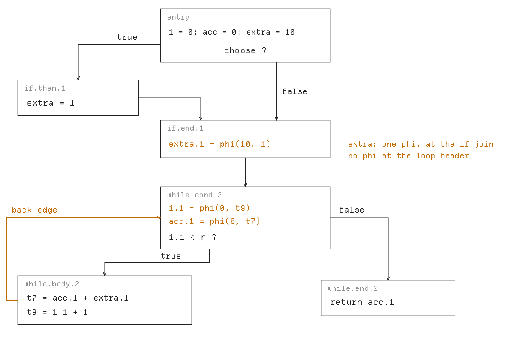

# PA5: SSA Construction and Local Optimization

*What must survive a loop?*

**Due: Monday, November 30, 11:59 pm (Pacific).** Released Monday, November 16.

**What to do:** complete **Exercises 1 to 3** in `compiler/ssa.py` and `compiler/local_opt.py`. Hand in your AI sessions, a design document in `docs/pa5-design.md`, or both. Section 7 says how to hand them in.

PA5 takes the IR your compiler already generates and improves it in two passes. **SSA construction** replaces local-variable loads and stores with named values. **Local optimization** folds constants and reuses repeated computations. The program's output and runtime-error behavior must stay the same.

Work through this handout in order: set up, inspect the IR, compute dominators, build SSA, simplify blocks, then run the supplied tests and submit.

## 1 Set up your PA5 folder

Run the commands below. `join` downloads the PA5 starter into a new folder and opens a shell there. Replace the invite code and PA4 path; quote paths containing spaces.

```sh
curl -fsSL https://downloads.oneworldai.com/oneworld-cli/install.sh | sh
oneworld assessment join <PA5 invite code>
python3 tools/carry.py ../PA4_FOLDER
python3 tools/doctor.py
python3 tools/check.py pa1 pa2 pa3 pa4
```

Run `carry.py` before editing the new folder. It copies your compiler modules, tests and design documents while retaining the new course files. If it reports conflicts, it copies nothing; compare the listed files before choosing which versions to keep. Check that your earlier tests still pass.

You write four functions. The driver removes unreachable blocks before calling your passes. The first three functions go in `compiler/ssa.py`; `optimize` goes in `compiler/local_opt.py`.

| Function | Result |
|---|---|
| `immediate_dominators(fn)` | block label to immediate-dominator label |
| `dominance_frontiers(fn, idom)` | block label to a set of frontier labels |
| `construct(fn)` | changes `fn` in place; returns `None` |
| `optimize(fn)` | changes `fn` in place; returns `None` |

**The 80 code points are tested on staff-provided IR**, independently of your earlier compiler stages. All grading tests are included; you do not need to write tests. Helpers you add under `compiler/` are submitted too.

All 28 grading tests are in `test/pa5/`: each `.py` program has a matching `.ll` input. Run:

```sh
python3 tools/opttest.py -O1 test/pa5
```

The stubs are not expected to pass the suite. After Exercise 3, all **28/28** must pass. `-O1` runs SSA construction followed by local optimization. `opttest` verifies the resulting IR, checks its test comments, then runs it and compares its behavior with Python.

## 2 Read the IR you will change

### 2.1 From a variable to an SSA value

A **basic block** is a sequence entered at its first instruction and left at its last. The **control-flow graph** (CFG) has one node per block and an edge for each possible jump. An edge connects a predecessor to a successor. The starter already builds this graph. The entry block is `fn.blocks[0]`; use its label. These examples call it `entry`.

Your compiler translates `acc = acc + extra` using a stack slot for each local variable:

```llvm
  %t5 = load i32, ptr %acc.addr
  %t6 = load i32, ptr %extra.addr
  %t7 = add i32 %t5, %t6
  store i32 %t7, ptr %acc.addr
```

**SSA** means each name has one definition. `%t7` already has one definition, but `%acc.addr` holds a value that changes. To promote this slot, replace each load with the value it should read, then delete the slot and its stores. Recognize slots from instructions, not names such as `.addr`.

At a join, different paths may supply different values. A **phi** picks the value for the edge control arrived on. This example picks `10` from `entry` or `1` from `if.then.1`:

```llvm
if.end.1:
  %extra.1 = phi i32 [ 10, %entry ], [ 1, %if.then.1 ]
```

Phis go at the top of their block, with one `(value, predecessor)` pair per incoming edge. A loop-header phi picks the initial value on entry and the updated value on the back edge.

### 2.2 One example to follow

Use `test/pa5/total.py` throughout Exercises 1 and 2:

```python
def total(n: int, choose: bool) -> int:
    i: int = 0
    acc: int = 0
    extra: int = 10
    if choose:
        extra = 1
    while i < n:
        acc = acc + extra
        i = i + 1
    return acc

print(total(3, True))
print(total(3, False))
```

It prints `3`, then `30`. The branch chooses `extra`; the loop updates `i` and `acc`. The complete input IR is in `test/pa5/total.ll`. Figure 1 shows its blocks, with statements written in a shorter notation.



**Figure 1.** The CFG of `total`. The colored phis are the ones added by SSA construction. They choose `extra` after the branch and `i` and `acc` at the loop header.

### 2.3 The Python objects

`compiler/ir.py` reads LLVM text into objects. Open a Python shell in your PA5 folder:

```text
$ python3 -q
>>> from compiler import ir
>>> fn = ir.parse(open("test/pa5/total.ll").read()).functions[0]
>>> fn.block("entry").successors()
['if.then.1', 'if.end.1']
```

| Object or method | What you use it for |
|---|---|
| `fn.blocks`, `fn.block(label)` | visit blocks; find one by label |
| `block.label`, `block.instrs` | read its label; edit its instruction list |
| `block.successors()`, `fn.predecessors()` | get successor labels; map labels to predecessor labels |
| `instr.op`, `instr.result`, `instr.type`, `instr.args` | inspect the operation, result name, type and input values |
| `Instr("phi", "%x.1", "i32")` | make a phi; import `Instr` from `compiler.ir` |
| `phi.incoming` | fill its list of `(value, label)` pairs |
| `fn.replace_all_uses(old, new)` | replace a value in all instruction inputs and phi incoming values |
| `fn.params` | parameter `(type, name)` pairs, for avoiding name collisions |

Values are strings such as `'%t1'`, `'10'`, `'true'` or `'undef'`. Labels have no `%`. For example, append a phi input with `phi.incoming.append(('10', 'entry'))`, without `%` on the label.

The three memory instructions have these fields (`type` is the stored value's type):

| `op` | `result` | `args` |
|---|---|---|
| `alloca` | the slot name | `[]` |
| `load` | the loaded value's name | `[address]` |
| `store` | `None` | `[value, address]` |

The `Instr` docstring describes the remaining fields.

## 3 Compute dominators and frontiers

Block `d` **dominates** block `b` if every path from `entry` to `b` passes through `d`. Every block dominates itself. **Strict dominance** excludes the block itself. The **immediate dominator** is the closest strict dominator; linking each block to it gives the dominator tree.

In `total`, `while.cond.2` dominates both the body and exit. `if.then.1` does not dominate the loop: control can skip that branch.

### 3.1 Compute immediate dominators

Compute the dominator sets as follows:

1. Set `Dom(entry) = {entry}`. Start every other block's set with all blocks.
2. For each non-entry block `b`, intersect its predecessors' dominator sets, then add `b` itself.
3. Repeat until no set changes. Keep the entry set fixed.
4. From each block's strict dominators, choose the one dominated by every other strict dominator. Return its label. Map `entry` to itself.

You may compare your results with `fn.dominators()`, but compute them yourself. Other correct algorithms are allowed.

### 3.2 Compute dominance frontiers

The **dominance frontier** of `d` contains each block `y` where `d` dominates a predecessor of `y` but does not strictly dominate `y`. These are the joins where definitions from different paths can meet. A loop header can belong to its own frontier.

Start with an empty set for every block. For each join `y` with at least two predecessors, walk up the dominator tree from each predecessor. Add `y` to every visited block's frontier, stopping before `idom[y]`.

For `total`, the results are:

| Block | Predecessors | Immediate dominator | Dominance frontier |
|---|---|---|---|
| `entry` | none | none | none |
| `if.then.1` | `entry` | `entry` | `if.end.1` |
| `if.end.1` | `entry`, `if.then.1` | `entry` | none |
| `while.cond.2` | `if.end.1`, `while.body.2` | `if.end.1` | `while.cond.2` |
| `while.body.2` | `while.cond.2` | `while.cond.2` | `while.cond.2` |
| `while.end.2` | `while.cond.2` | `while.cond.2` | none |

The table says `none` for the entry's immediate dominator; your dictionary represents that as `entry`. Empty frontiers are empty sets.

> **Exercise 1** (20 points). Write `immediate_dominators(fn)` and `dominance_frontiers(fn, idom)` in `compiler/ssa.py`. Include every block in both dictionaries.
>
> **Check:** continue in the Python shell from Section 2.3 with the commands below. Compare every block with the table above before starting Exercise 2.

```text
>>> from compiler import ssa
>>> idom = ssa.immediate_dominators(fn)
>>> df = ssa.dominance_frontiers(fn, idom)
>>> for b in fn.blocks: print(b.label, idom[b.label], sorted(df[b.label]))
...
```

## 4 Construct SSA

Write `construct(fn)` in the following order. It changes the function in place.

### 4.1 Identify promotable slots

A slot is **promotable** if its `alloca` is in `entry` and every use of its address is a load from or store to the whole slot. Do not promote an address passed to a call, stored as a value, or used another way. Parameters, locals, and compiler-generated slots for `and`, `or`, conditional expressions and `for` may qualify.

Keep loads and stores to other memory, including globals and list elements. Track each promotable slot and its type (`i32`, `i1` or `ptr`). For a store, the slot may appear as `args[1]`, never as the stored value in `args[0]`.

**Check before rewriting:** `total` has five promotable slots: `%n.addr`, `%choose.addr`, `%i.addr`, `%acc.addr` and `%extra.addr`.

### 4.2 Place phis

For each slot:

1. Put all blocks that store to it on a worklist.
2. Remove a block and visit its dominance frontier.
3. At each frontier block without a phi for this slot, insert one and add that block to the worklist.
4. Repeat until the worklist is empty.

**A phi is a new definition, so its frontier must also be considered.** Each block gets at most one phi per slot. Insert it at the start of `block.instrs` with any existing phis, use the slot's type, and choose a fresh name that conflicts with no result or parameter. Leave incoming values empty until renaming. Unused phis may stay.

In `total`, `extra` needs a phi at `if.end.1`; `i` and `acc` need phis at `while.cond.2`. **Check before renaming:** there should be exactly these three phis, with types `i32`. Their incoming lists are still empty, so verification is expected to fail until renaming fills them. The parameters need none, since only `entry` stores to them. `extra` needs no loop-header phi because the loop never changes it.

### 4.3 Rename and remove memory operations

Keep one stack per slot. Its top is the current value; popping restores the value from before the current block. Start each stack with `undef` and visit `entry`. Build the tree from `idom`, but skip its `entry -> entry` mapping: entry must not be its own child.

At each block:

1. Scan instructions in order. A phi you inserted pushes its result. A store to a promoted slot pushes its value. Replace every use of a load's result with the top of its slot's stack, including uses in other blocks.
2. For each **CFG successor**, fill the phis you inserted there with `(current value, this block's label)`. Include back edges.
3. Visit each **dominator-tree child** with the current stacks.
4. Pop exactly what this block pushed, restoring the values for the next sibling.

After the walk, delete the promoted allocas and their loads and stores. CFG successors receive phi inputs; dominator-tree children are the blocks you recursively visit. These are different sets.

Follow `acc` in `total`: entry pushes `0`; the header's phi pushes `%acc.1`; the body computes and pushes `%t7`, then sends it to the header's phi. Pop `%t7` after visiting the body. The sibling exit block then returns `%acc.1`, which is valid even if the loop runs zero times.

`undef` marks a value not set on that path. ChocoPy initializes declared variables before use, but compiler-generated slots can be set only inside a branch or loop. An unused phi may therefore receive `undef`. Keep such phis or remove them; do not treat them as uninitialized source-variable errors.

Inspect your result with:

```sh
python3 -m compiler opt --passes=ssa --verify test/pa5/total.ll
```

`--verify` checks each function after each pass, including whether each definition dominates its uses. Use it when running passes yourself; clang alone does not catch every invalid SSA use.

> **Exercise 2** (40 points). Complete `construct(fn)`. Remove every promoted slot and its loads and stores, preserve behavior, and produce IR that passes verification.
>
> **Check:** run `python3 tools/opttest.py -O1 test/pa5`. SSA tests should pass; tests requiring local optimization can still fail until Exercise 3. Inspect the `--passes=ssa` output for `total.ll`, which should have three phis and no allocas. Then inspect that output for `nested_loops.ll`: phi placement must continue through the frontier of newly inserted phis, not stop after one round.

## 5 Simplify each block

Write `optimize(fn)` in `compiler/local_opt.py`. Scan each block from top to bottom. Repeat until a full scan of the function changes nothing. Start a fresh value-numbering table each time you enter a block.

Whenever a result is replaced, use `fn.replace_all_uses` to replace it **throughout the function**, then delete its defining instruction. A later block can use that result even though the expression was found locally.

### 5.1 Fold constants and apply identities

When an instruction's input values are constants, compute its result during compilation. For example, replace `%t7 = mul i32 3, 4` with `12`. Recognize numeric literals and `true`/`false` explicitly; `undef` is not a foldable constant, and `null` is a pointer value, not an integer. Follow LLVM arithmetic:

| Instruction | Folded value |
|---|---|
| `add`, `sub`, `mul` on `i32` | the result, wrapped around into the 32-bit range: `add i32 2147483647, 1` is `-2147483648` |
| `sdiv`, `srem` | rounded toward zero: `sdiv i32 -7, 2` is `-3` and `srem i32 -7, 2` is `-1`, not Python's `-4` and `1` |
| `icmp` | `true` or `false`; `slt`, `sle`, `sgt` and `sge` compare signed numbers |
| `and`, `or`, `xor` on `i1` | the Boolean result: `xor i1 true, true` is `false` |
| `zext` or `sext` from `i1` to `i32` | `0` for `false`; for `true`, `1` (`zext`) or `-1` (`sext`) |
| `select i1 c, a, b` | `a` if `c` is `true`, else `b` |

For other integer widths, preserve that width when folding, or leave the instruction unchanged. Do not apply 32-bit wrapping to an `i64` address calculation.

For `select`, a constant condition alone is enough: choose `a` or `b` even if that value is a name rather than a constant.

Also replace `add x, 0`, `add 0, x`, `sub x, 0`, `mul x, 1` and `mul 1, x` with `x`. Write Boolean constants as `true` and `false`.

Never fold division or remainder by zero, or `sdiv`/`srem` of `-2147483648` by `-1`. Their LLVM results are undefined. Keep runtime error checks. Value replacement still updates phi inputs and branch conditions, but do not simplify or delete those instructions. Even `br i1 false` stays; branch simplification belongs to PA6.

### 5.2 Reuse repeated expressions

A pure instruction computes from its input values without effects. For value numbering, use the operations in `ir.BINARY` plus `icmp`, `select`, `zext`, `sext`, `trunc`, `ptrtoint` and `getelementptr`. Give each expression a key containing its operation, type and input values. Include `instr.pred` for comparisons, `instr.to_type` for conversions, and `instr.index_types` as well as `instr.type` for `getelementptr`.

If the key already exists in this block's table, reuse the earlier result. Otherwise, record the new result. Sort the two inputs for commutative operations: `add`, `mul`, `and`, `or`, `xor`, `icmp eq` and `icmp ne`. Preserve their order for other operations.

For example, these instructions from `test/pa5/lvn.ll` repeat a computation:

```llvm
  %t2 = add i32 %x.arg, 1
  %t3 = mul i32 %t2, 2
  %t5 = add i32 %x.arg, 1
  %t6 = mul i32 %t5, 2
  %t7 = mul i32 3, 4
  %t8 = add i32 %t6, %t7
```

Replace `%t5` with `%t2`. Now `%t6` repeats `%t3`, so replace it too. Fold `%t7` to `12`. The last line becomes `%t8 = add i32 %t3, 12`.

**Calls and memory need different treatment.** Never merge calls: `tick() + tick()` must call twice. You do not need to merge loads. If you do, discard saved loads at every store or call; only reuse a load when neither has occurred since it was saved.

> **Exercise 3** (20 points). Complete constant folding, the listed identities and local value numbering in `optimize(fn)`.
>
> **Check:** `python3 tools/opttest.py -O1 test/pa5` must pass **28/28**. In particular, `fold_ir_semantics.py` checks signed arithmetic, `divzero_kept.py` checks preserved error behavior, and `calls_not_merged.py` checks effects. `make test-pa5` runs this same grading suite.

## 6 Run all grading tests

Run this command from your PA5 folder:

```sh
make test-pa5
```

You should see **28/28 passed** and **Everything passes.** This runs your passes on the supplied `.ll` inputs, so bugs in earlier compiler stages do not affect your PA5 code score. Staff use the same 28 tests on your submitted code, with fresh copies of the supplied inputs. There are **no hidden grading tests and no self-written tests to submit**. If all 28 pass when staff replay your submission, you earn all **80 implementation points**. The remaining 20 points assess your sessions or design document.

To investigate a failure, run one test directly, for example:

```sh
python3 tools/opttest.py -O1 test/pa5/loop_carried.py
```

Open its `.py` file to see the program and expected IR checks; its matching `.ll` file is the input to your passes. Do not change supplied tests to make them pass.

| If you are checking... | Start with these tests in `test/pa5/` |
|---|---|
| Branch joins and changing parameters | `join.py`, `elif_chain.py`, `params_reassigned.py` |
| Loop-carried values and nested loops | `loop_carried.py`, `nested_loops.py`, `rotate_carried.py` |
| Pointers, globals and calls | `ptr_slots.py`, `globals_across_calls.py`, `calls_not_merged.py` |
| Folding and repeated expressions | `fold_ir_semantics.py`, `identities.py`, `lvn_merge.py`, `lvn_not_merge.py` |
| Preserving runtime errors | `divzero_kept.py`, `divzero_not_folded.py` |

`ok` means passed; `FAIL` explains a mismatch. `TIMEOUT` means over 60 CPU seconds in your passes or 10 seconds in the executable. `BAD TEST` means invalid test setup. Read the first failure before editing.

## 7 Submit and check your receipt

Submit these two items from your PA5 folder:

- Your code for Exercises 1 to 3, including any helper modules.
- Relevant Claude Code or Codex sessions started in this folder, `docs/pa5-design.md`, or both. The design document is about one page under the template's headings, written by you. An AI-written design document earns no points.

```sh
make test-pa5
oneworld assessment status
oneworld assessment submit
```

Check that `status` names PA5. Submission includes earlier-assignment code and all changes Git does not ignore, committed or not. Select relevant PA5 sessions when prompted; a document-only submission needs none. Keep the receipt. No video or ZIP is required.

PA5 is worth **5% of the course grade**, with **100 points**:

| Item | Points |
|---|---|
| Exercise 1: dominators and frontiers | 20 |
| Exercise 2: SSA construction | 40 |
| Exercise 3: local optimization | 20 |
| Sessions or self-written design document | 20 |

Sessions and design documents are graded Excellent (20), Good (15), Fair (10), Poor (5), or missing (0). Both should explain your decisions and checks; short, substantive sessions suffice. If you submit both, staff grade them separately and keep the higher score.
