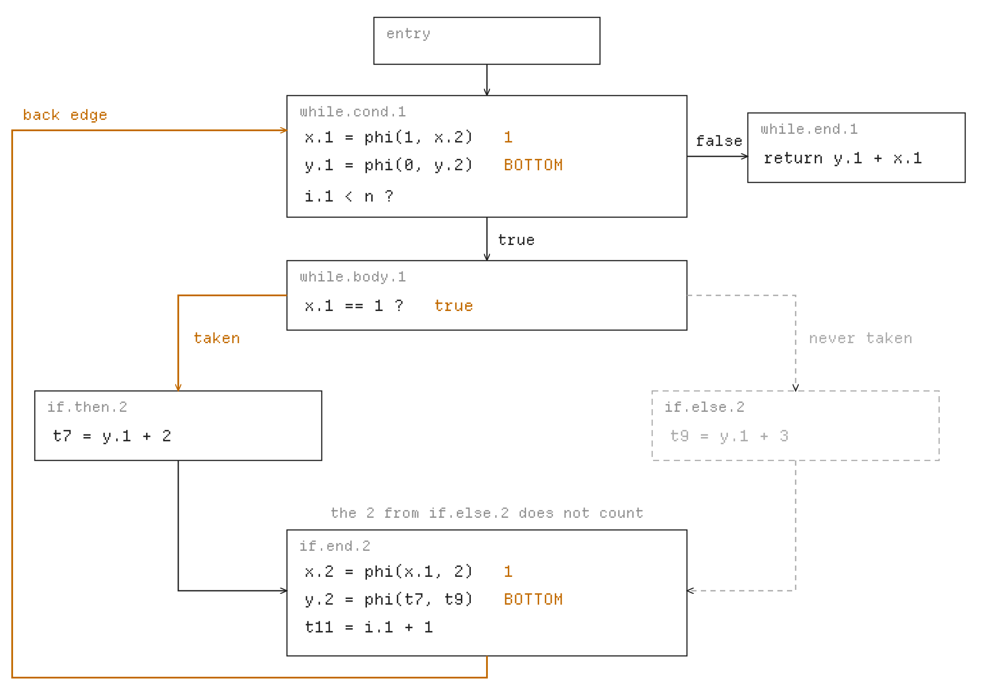

# PA6: Global Constant Propagation and Dead-Code Elimination

*When is it safe to delete code?*

**Due: Wednesday, December 9, 11:59 pm (Pacific).**

**What to do:** write `optimize(fn)` in `compiler/global_opt.py`. The compiler gives you one function at a time as a list of blocks of LLVM instructions. This is its **intermediate representation (IR)**. It is already in **static single assignment (SSA)** form: each name such as `%x.1` is defined once. Edit the function in place. Replace values you can prove constant, remove branches that cannot be taken, and delete unused calculations. Preserve what the program prints, including anything it prints before an error, and its exit code.

The three exercises below cover the implementation grade. Moving a calculation out of a loop (loop hoisting) is optional.

All **28 grading tests** are in the starter. You do not need to write any tests. When all 28 pass on your submitted code, you earn the **80 implementation points**. For the other **20 points**, submit your Claude Code or Codex chat history for this assignment, a design document you wrote, or both (Section 6).

## 1 Set up and run one test

Join the PA6 assessment using the invite code from staff. In the new PA6 folder, bring over your PA5 work before editing. In the first command, replace `YOUR_PA6_CODE` with your invite code. Run the remaining commands in the new PA6 folder. Replace `../PA5_FOLDER` with the path to your own PA5 folder (for example, `"../My PA5"`).

```sh
oneworld assessment join YOUR_PA6_CODE
python3 tools/carry.py ../PA5_FOLDER
python3 tools/doctor.py
python3 tools/opttest.py -O2 test/pa6/score.py
```

If `carry.py` reports a conflict, it copies nothing. Compare the files it lists before choosing which version to keep. If you need to install the `oneworld` command, follow the setup instructions on the PA6 assessment page.

**Expect `score.py` to fail with the starter.** Open `test/pa6/score.py`. Its first two comments say what the optimizer should do: remove an unused multiplication and keep a call that prints. The starter pass leaves the multiplication in place. Before you edit anything, `make test-pa6` should pass 6 of the 28 tests.

Each test has a `.py` file with the source program and a matching `.ll` file with the SSA input we supply. `opttest -O2` runs only your PA6 pass on that input. It checks that the rewritten function is valid, looks for the changes listed in the `.py` comments, then builds and runs the program to check what it prints and how it exits. You can work through every PA6 test even if an earlier compiler stage is unfinished.

## 2 Follow one value around a loop

Open `test/pa6/sccp_optimistic.py`. This is the example we will optimize:

```python
def f(n: int) -> int:
    x: int = 1
    y: int = 0
    i: int = 0
    while i < n:
        if x == 1:
            y = y + 2
        else:
            y = y + 3
            x = 2
        i = i + 1
    return y + x

print(f(5))
print(f(0))
```

It prints `11`, then `1`. On the first trip, `x` is `1`. The true branch leaves `x` alone, so it will still be `1` on the next trip. The only assignment of `2` to `x` is in the branch we can never enter. Your optimizer should discover this, remove the `else` branch, and keep the loop: the number of trips still depends on `n`.

Open the matching `.ll` file. A block is a sequence of instructions that run in order. The block that tests whether the loop should continue is its **header**. Its first instruction is:

```llvm
  %x.1 = phi i32 [ 1, %entry ], [ %x.2, %if.end.2 ]
```

A **phi** chooses its value using the block we arrived from. On the first visit, we arrive from `entry`, so `%x.1` is `1`. The second pair tells us where to look for `x` on subsequent trips. We need to track both **values** and **edges** (jumps between blocks) to decide which pairs can contribute.



**Figure 1.** Follow the arrow from the loop body back to the header (the **back edge**) to see why the phi for `x` keeps receiving `1`. The branch that would supply `2` is never taken.

## 3 Find constants and executable edges

This analysis is called **sparse conditional constant propagation** (SCCP). Implement it first, without editing any instructions. For each SSA name, record what you know about its value. For each jump the program might take, record the pair `(source label, target label)`. Two blocks might both run even if the jump between them is never taken. Keep these results until Section 4.

### 3.1 Start with three states

- **TOP** means we have no evidence yet. A phi starts here before we see any jump into its block.
- **Constant** means all evidence so far agrees on a value, such as the integer `1` or Boolean `true`.
- **BOTTOM** means the value could vary or the analysis cannot compute it. Examples include function parameters and values loaded from memory.

Start a fresh analysis for each function. Mark the first block (`fn.blocks[0]`) executable. Parameters start at `BOTTOM`, other SSA names at `TOP`. Read integer and Boolean literals directly. Treat `undef` as `TOP`. You may treat pointer values such as `null` and `@global` as `BOTTOM`. Use a distinct marker for each special state. In Python, `0 == False` and `1 == True`, so keep track of the IR type when comparing constants.

### 3.2 Evaluate the instructions in each executable block

- **Phi:** use only pairs whose incoming edge is executable. Start at `TOP`. Combining `TOP` with any value gives that value. Equal constants stay constant. Different constants give `BOTTOM`. Combining `BOTTOM` with anything gives `BOTTOM`.
- **Branch:** mark the edge for an unconditional jump. For a conditional jump, mark the true or false edge if you know the condition, both edges if it is `BOTTOM`, or neither yet if it is `TOP`. The true target comes first in `instr.targets`.
- **Select:** if the condition is constant, take the chosen value. For `BOTTOM`, combine both alternatives with the phi rule. For `TOP`, wait for more evidence.
- **Arithmetic, comparisons and integer conversions:** if any input is `BOTTOM`, the result is `BOTTOM`. Otherwise wait while any input is `TOP`. When all are constants, evaluate using LLVM's rules. If you cannot safely compute the result at compile time, record `BOTTOM`.
- **Calls, loads and address calculations:** treat their results as `BOTTOM`. This analysis works within one function and does not track memory contents.

Respect the instruction's integer width. For example, adding `1` to `2147483647` at `i32` gives `-2147483648`. Signed division rounds toward zero: `-7 / 2` gives `-3`, with remainder `-1`. Use `BOTTOM` for division or remainder by zero and for signed division or remainder of the minimum signed integer by `-1`. You may also use `BOTTOM` for unsigned division, unsigned remainder and shifts. Write `i1` constants as `true` or `false`. Extending `true` to `i32` gives `1` with `zext` and `-1` with `sext`.

### 3.3 Revisit what changed

A worklist is a list of items that need another look. Start by putting the entry block on the worklist. Then use these rules:

1. **First visit to a block:** evaluate every instruction there, including its final branch.
2. **A value changes:** revisit instructions in executable blocks that read it, including branches and phis. For each instruction, `instr.uses()` lists the names it reads. For each name it reads, add the instruction to that name's list. When the name changes, revisit the instructions on its list.
3. **A new edge reaches an already executable block:** revisit that block's phis. They now have another incoming value to consider.
4. When the worklist empties, check for executable branches whose condition is still `TOP` (for instance, `undef`). Treat both jumps as possible. Add work only for newly discovered edges. Stop when this adds no work.

A name can move from `TOP` to a constant and later to `BOTTOM`. An edge, once marked executable, stays marked. Once no value changes and no new edge can be added, the analysis has reached its **fixed point**. Only then start editing instructions.

Trace the running example with these three checkpoints:

| When | What you should find |
|---|---|
| `entry` first reaches the loop header | `%x.1` is `1`. The loop test depends on `%n.arg`, so both the body and the exit can run. |
| The body tests `%x.1 == 1` | `%t5` is `true`. Only the edge to `if.then.2` is taken. `%x.2` gets `1` from that path. |
| The back edge reaches the header | `%x.1` combines `1` and `1`, so it stays `1`. The values of `y` and `i` vary. `if.else.2` is still unreachable. |

> **Exercise 1** (35 points). Compute the SCCP values and executable edges for one function. Reconsider phis when an incoming edge is discovered, even if the block has already been visited.
>
> **Check:** after the analysis stops, compare your results with the two cases below. For this check, `optimize(fn)` can leave `fn` unchanged.

- For `sccp_optimistic.ll`, check `fn.name == "fn.f"`. Both `%x.1` and `%x.2` should be `1`. `%t5` should be Boolean true, and `if.else.2` should be absent from the blocks you marked.
- For `revisit_lattice.ll`, check `fn.name == "fn.h"`. `%x.1` can be `1` on entry and `2` on a later iteration. Its final state should be `BOTTOM`.

To see your results, temporarily print those entries inside `optimize` using `import sys` and `print(..., file=sys.stderr)`. Run both commands. They hide the generated IR so you can read your prints. Remove the prints after checking.

```sh
python3 -m compiler opt --passes=global test/pa6/sccp_optimistic.ll > /dev/null
python3 -m compiler opt --passes=global test/pa6/revisit_lattice.ll > /dev/null
```

## 4 Rewrite the function

Now use the finished analysis to edit `fn` in place. The IR helpers in `compiler/ir.py` work with strings: `phi.incoming` holds `(value, label)` pairs, such as `('1', 'entry')`. A block label has no `%` in these fields.

1. **Replace constants.** For each name proven constant, call `fn.replace_all_uses(old, new)` with the name and the replacement text, for example `fn.replace_all_uses("%x.1", "1")`. This also updates phi inputs and branch conditions.
2. **Fold branches.** Replace a branch whose condition is now `true` or `false` with `Instr("br", targets=[taken])`. If the two targets differ, remove this block's incoming pair from every phi at the dropped target. If both labels name the same block, keep its phi inputs. The target itself might still run via a different edge.
3. **Remove unreachable blocks.** Keep only executable blocks in `fn.blocks`. Remove phi pairs naming deleted predecessors. When simplifying a phi, ignore inputs that refer to its own result. If at least one other input remains and all such inputs give the same value, replace every use of the phi result with that value and delete the phi. Revisit other phis this simplifies.
4. **Remove unused calculations.** Collect the names read by `instr.uses()` across the whole function. Remove an instruction when it defines an unused result and `instr.has_side_effects()` is false. Repeat: deleting the last use of one result can make the instruction that produced it dead too.
5. **Merge straight-line blocks.** If `B` ends with an unconditional jump to `C`, and `B` is the only predecessor of `C`, they can be one block. Skip self-jumps and jumps back to the function entry. Replace each phi in `C` by its sole input. Replace the jump in `B` with the non-phi instructions of `C`. Change incoming labels from `C` to `B` in the phis of its successors, then delete `C`. After each merge, recompute predecessors and restart the scan over `fn.blocks`.

In the running example, the inner branch becomes unconditional, so `if.else.2` disappears. The two phis for `x` disappear too. The loop still needs the header phis for `y` and `i`. At the exit, the final addition now reads:

```llvm
  %t14 = add i32 %y.1, 1
```

> **Exercise 2** (25 points). Use the analysis to replace constants, repair branches and phis, delete dead code, and merge blocks.
>
> **Check:** inspect the output of the first command below. With the steps above, `@fn.f` has two remaining phis and adds `1` at the end. The test accepts different SSA names and at most two phis if you simplify further. The second command checks the input with the loop and another input with a chain of blocks to merge.

```sh
python3 -m compiler opt --passes=global --verify test/pa6/sccp_optimistic.ll
python3 tools/opttest.py -O2 test/pa6/sccp_optimistic.py test/pa6/merge_chain.py
```

If verification reports the wrong phi inputs, compare that phi's labels with `fn.predecessors()[block.label]`. Each remaining predecessor needs exactly one pair.

## 5 Preserve output and errors

A calculation can have an unused result and still do something the program needs. In a reachable block, keep every `call`, even if the return value is unused. A **side effect** is something an instruction does besides producing a value. A call can print, modify a global, or stop with an error. Keep every reachable `store`. Each remaining block must still end with a valid branch, `ret`, or `unreachable` after the rewrites in Section 4. Calls and stores inside a block you prove unreachable may disappear with that block.

For example, reading an unused list element still has to check for `None` and an out-of-bounds index. You can delete the unused element load. Keep any reachable check, its error call, and all output that happens before the error. In `fail_kept.ll`, the program prints `7` and calls `@cp_error_div`. Keep that error call. The `sdiv` is in the unreachable block and disappears.

| To check this behavior | Run `opttest` on this file in `test/pa6/` |
|---|---|
| Remove unused arithmetic, keep a printing call | `score.py` |
| Keep calls and stores while removing a chain of dead results | `dce_effects.py` |
| Keep the output and exit code for an invalid index | `error_path_kept.py` |
| Preserve division-by-zero failure even when its result is unused | `fail_kept.py` |

> **Exercise 3** (20 points). Preserve each program's output, exit status and reachable side effects while applying the required optimizations.
>
> **Check:** run `make test-pa6` in your PA6 folder. The goal is **28/28 passed**. Staff replay these same 28 tests on your submission using fresh copies of the supplied inputs. To investigate a failure, run one test directly, for example `python3 tools/opttest.py -O2 test/pa6/dce_effects.py`.

**Optional timing.** To time code produced by your full compiler, run `python3 tools/bench.py test/bench/matmul.py`. The six programs in `test/bench/` are for measuring performance. Your PA6 grade does not depend on a speedup or leaderboard rank.

## 6 Submit and check your receipt

Submit your implementation, including any helper modules under `compiler/`. For the last 20 points, select relevant Claude Code or Codex sessions started in your PA6 folder, submit `docs/pa6-design.md`, or do both. If you choose the document, write it yourself in about a page, using the template's headings. Explain a decision you made and how you checked it with the supplied tests. An AI-written design document earns no points.

1. Run `make test-pa6` in your PA6 folder.
2. Run `oneworld assessment status`. Check that it says **PA6**.
3. Run `oneworld assessment submit`. If you are submitting sessions, select them when prompted. If you are submitting your code and design document, you can skip session selection. Keep the receipt.

PA6 is worth **5% of the course grade**. Exercises 1, 2 and 3 are worth **35, 25 and 20 points**, respectively. Sessions and design documents are graded Excellent (20), Good (15), Fair (10), Poor (5), or missing (0). If you submit both, staff grade them separately and keep the higher score.
